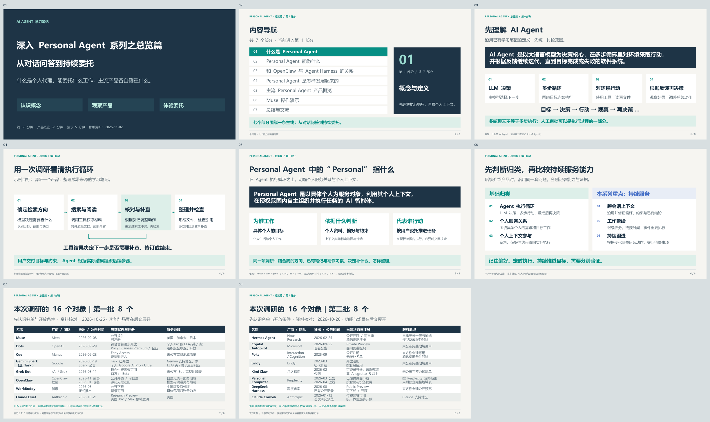
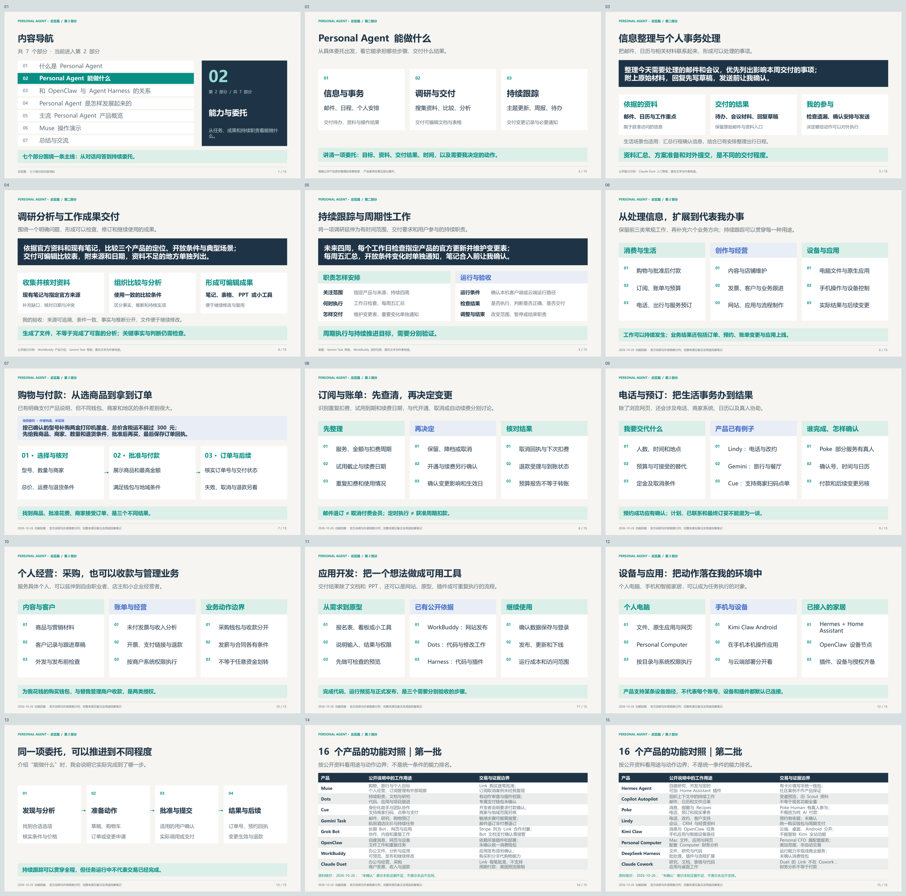
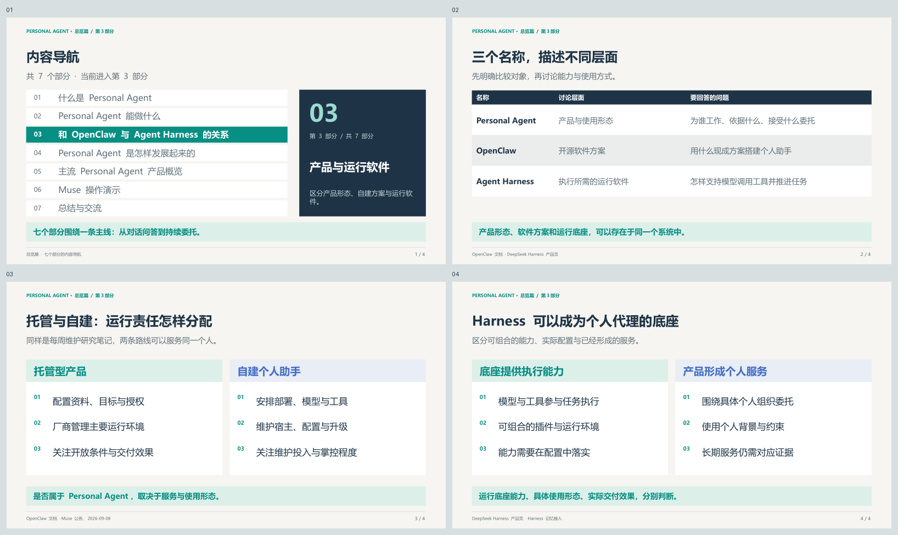
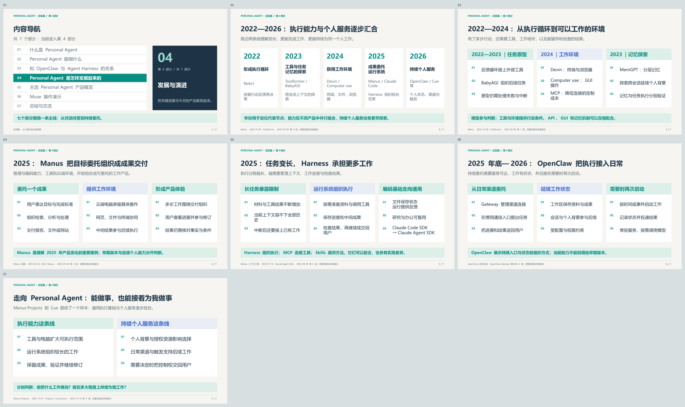
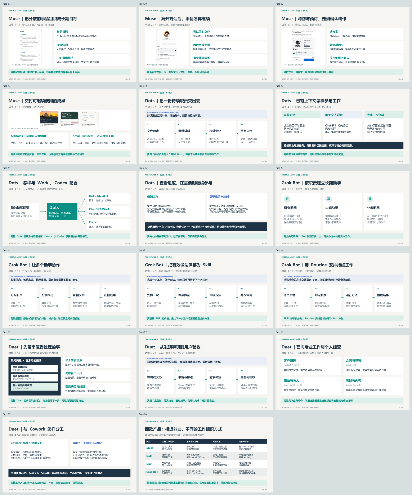
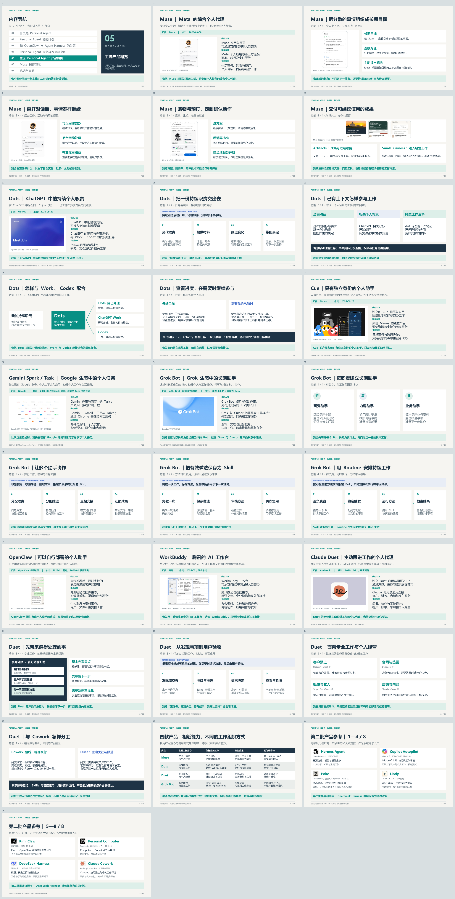
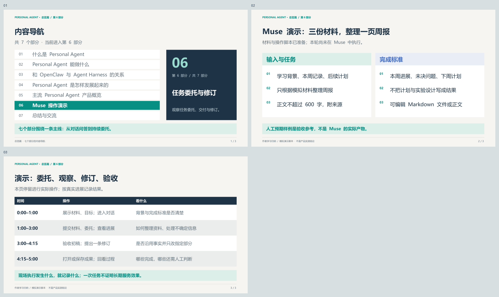
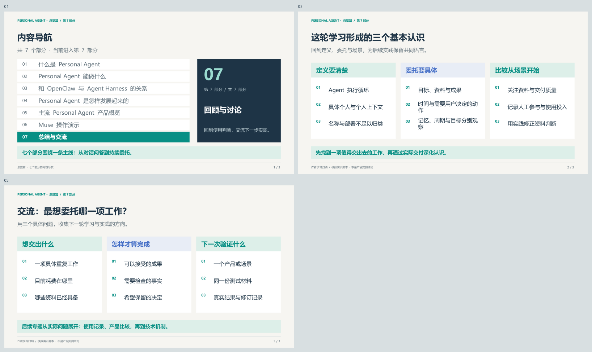

## 前言

2022 年底，ChatGPT 让通过自然语言对话获取答案、生成内容成为大众熟悉的 AI 使用方式。随着工具调用、执行环境和持续工作能力的发展，今天的 Personal Agent 正在探索进一步的协作方式：结合个人背景理解目标，长期跟进一项工作，根据变化调整行动，持续推进任务，并在需要用户判断时交回控制权。用户开始尝试把完整任务和持续职责委托给 AI。

本次分享是 Personal Agent 系列的第一篇，从 AI Agent 与 Personal Agent 的基本概念出发，简要梳理技术发展与产品演进，介绍第一批八款产品的厂商、推出时间、产品生态与业务侧重，并简要认识第二批八款参考对象，建立对 Personal Agent 产品形态和主要用途的初步认识。

## 什么是 Personal Agent

### 先理解 AI Agent

讨论 Personal Agent 之前，我们先看看什么是 Agent。这里我先给出一个我参考社区各种说法之后的个人总结的 [AI Agent 的定义](/definition/what-is-ai-agent/)：

> **AI Agent 是以大语言模型为决策核心，在多步循环里对环境采取行动，并根据反馈继续迭代，直到目标完成或失败的软件系统。**

这个定义包含四个要素：**由模型决定下一步，能够多步执行，能够对环境采取行动，并根据行动结果继续决策。** 这是我总结的 AI Agent 的定义，范围比传统人工智能中的 Agent 更窄。

以“调研一个产品并整理笔记”为例，Agent 可以先搜索资料、打开原始文档，发现来源过期或说法冲突后补查，再整理文件、检查引用。模型根据每一步的结果决定下一步，形成“决策 → 行动 → 观察 → 再决策”的循环。

因此，**多轮聊天不等于多步执行**，单次工具调用也不足以说明存在这样的循环。用户可以随时补充要求或审批重要动作，自主执行并不要求全程无人参与。

### Personal Agent 中的“Personal”指什么

研究资料对 Personal Agent 的表述各有侧重：2024 年的[综述](https://arxiv.org/html/2401.05459v2#S3)强调与个人数据、设备和服务结合；W3C AI Agent Protocol 社区组的[用例材料](https://www.w3.org/2024/01/webevolve-series-events/annual-2025/slides/ai-agent-protocol-cg.pdf)强调代理代表的用户及其利益。后者是社区组讨论材料，不是 W3C 正式标准。

结合这些资料，我在本次调研中采用以下定义：

> **Personal Agent 是以具体个人为服务对象，利用其个人上下文，在授权范围内自主组织并执行任务的 AI 智能体。**

我主要从三个方面理解其中的“个人”：

- **为谁工作**：服务于具体个人的目标，既包括生活事务，也包括个人工作。
- **依据什么判断**：个人资料、偏好、工作背景和约束会影响选择与行动，Personal Agent 不只是给通用助手简单换一个名字。
- **代表谁行动**：根据用户委托使用工具、推进任务，并在需要时把决定权交回用户。

仍以调研为例：如果它能结合我的研究方向、已有笔记和写作习惯，优先补充尚未覆盖的资料，按我要求的方式整理，个人上下文就实际参与了工作。这里描述的是一个示例，用于解释判断方式，不是某个产品的实测结果。

### Personal Agent 调研范围选择

在做这次 Personal Agent 系列分享之前，我对目前社区的主要 Personal Agent 产品进行了调研。我会先检查产品是否具备前述 Agent 执行循环（先判断是不是 AI Agent），再判断它是否围绕具体个人工作、个人上下文是否影响执行（再看是不是 Peasonal Agent）。注意：不能仅凭“个人使用”或产品名称就定义是或者不是 Personal Agent 。

在基础归类之上，我认为 Personal Agent 应该更关注**能够长期服务个人、跨会话延续工作的代理**。因此，我我会进一步分别检查：

| 观察维度 | 要确认的问题 |
| --- | --- |
| 跨会话上下文 | 能否在后续工作中沿用并修正偏好、约束和已有结论？ |
| 工作延续 | 能否继续未完成的任务，或按时间、事件承担重复性工作？ |
| 持续跟进 | 能否根据变化调整后续动作，并在需要用户判断时联系用户？ |

记住偏好、定时执行与持续推进目标，是不同的能力，不能相互替代。长期服务是本系列的研究重点，不把所有能力齐备作为统一的准入门槛；单次委托也可以发生在 Personal Agent 中。

独立电脑、云端常驻、多代理协作属于具体产品路线。后面介绍主流产品时，我会沿用上述标准，区分个人使用形态、团队模式和运行底座，并将官方说明与实际验证分开记录。

**资料说明：** 本节整理于 2026-10-24。综述使用 2024-05-08 修订的 v2；社区组材料来自 2025 年活动，两项外部来源均于 2026-10-24 阅读。Personal Agent 的工作定义与判断方法是我的归纳，不代表统一行业标准。

## Personal Agent 能做什么

本节约 14 分钟，保留三类常规委托，补充实际业务用途与 16 个对象的功能对照；第五部分按厂商、生态与业务侧重认识产品。

有了定义，我更关心哪些工作可以交给 Personal Agent。我把调研中看到的应用归为三类：信息与事务、调研与交付、持续跟踪。下面用具体委托说明输入、处理过程和交付结果，不要求每个产品都具备全部能力。

### 信息整理与个人事务处理

日常有不少工作分散在邮件、日历和文件中：判断哪些消息需要回复，找出会议前要看的资料，或者协调一个合适的时间。这类工作的难点往往在于把相关信息联系起来，并落实后续动作。

例如，可以这样委托：

> 帮我整理今天需要处理的邮件和会议。优先列出影响本周交付的事项，附上原始邮件和相关材料；需要回复的先写草稿，发送前让我确认。

这项委托需要读取获准访问的邮件和日历，结合我的工作重点筛选事项，再形成待办清单、会议资料和回复草稿。我需要检查它是否遗漏关键事项、安排是否合适，并决定哪些内容可以发出。晨间邮件与日历简报、回复草稿已有相应的[官方产品说明](https://support.claude.com/en/articles/17631495-get-started-with-claude-duet)。

同样的方式也可以用于生活事务，例如汇总行程确认信息，结合已有安排整理出行日程。具体能读取哪些服务、能否修改日程或完成预订，取决于产品接入与授权范围。**资料汇总、方案准备和对外提交，是不同的交付程度。**

### 调研分析与工作成果交付

与我的工作更相关的一类，是把分散资料整理成可以继续使用的成果。我希望委托的不仅是检索，还包括筛选来源、核对差异、组织分析，以及按要求更新文档和表格。

例如：

> 根据指定的官方资料和现有笔记，比较三个产品的定位、开放条件与典型场景。把结论写入比较表，附上来源和日期；资料不足的地方单独列出，不替我补猜。

这项工作需要利用已有材料确定比较范围，再补充资料、交叉核对，并形成可编辑的文件。输出可以是研究笔记、数据分析表、演示材料，也可以是一个用于展示结果的小工具。文件处理、自主规划执行与文档、表格、PPT 交付，可以在 [WorkBuddy 的公开说明](https://www.workbuddy.cn/docs/workbuddy/Overview)中找到具体例子。

我会把验收重点放在来源能否追溯、比较条件是否一致、事实与推断是否分开，以及成果是否便于继续修改。**生成了文件，不等于完成了可靠的分析。** 关键判断仍需要我检查，缺少资料时也应保留问题。

### 持续跟踪与周期性工作

前两类委托可以有明确的结束点。还有一些工作需要重复进行，并在发生变化时接着处理，例如主题跟踪、周报整理和待办跟进。

我可以把前面的调研延伸为一项持续职责：

> 未来四周，每个工作日检查指定产品的官方更新。维护变更表，标明发布日期与来源；每周五给我一份汇总。如果开放条件发生变化，单独通知我。先准备笔记补充草稿，合入前让我确认。

这比“每天给我一份新闻”更具体：它说明关注对象、时间范围、交付位置，以及哪些变化需要打扰我。[Gemini Task 官方帮助](https://support.google.com/gemini/answer/17094507?hl=en)包含持续任务、信息跟踪和文件交付的示例，但具体触发与动作仍需按产品确认。

持续工作还需要可用的运行环境。以 [WorkBuddy 定时任务](https://www.workbuddy.cn/docs/workbuddy/From-Beginner-to-Expert-Guide/Function-Description/Automation-Guide)为例，本地任务由本机客户端执行，云端任务则在云端沙箱运行、无需电脑在线；不能把一种路径的条件套到另一种路径。

对这类委托，我会关注每次检查是否执行、变化是否判断正确、结果是否交付，以及怎样调整或结束这项职责。周期执行不自动等于持续推进目标，后台工作也会受到资源、权限和用量限制。

从这些场景出发，我表达委托时会尽量讲清楚：**做什么、依据哪些资料、交付什么结果、什么时候完成，以及哪些动作需要我决定。** 后面比较产品，也会沿着这些具体工作看它们各自擅长什么。

**资料说明：** 本节整理于 2026-10-24，引用的四篇官方帮助与产品说明均于当日读取，属于动态文档，不将阅读日期当作发布日期。以上委托为我归纳的场景示例，没有新增产品实测；可用能力取决于地区、套餐、版本、连接服务及具体授权，产品差异留到第五部分展开。

### 从三类常规工作，补充到实际业务用途

我保留前面的三类用途，再补充购物付款、订阅账单、电话预订、个人经营、应用开发和设备操作。持续跟踪是一种工作方式，可以贯穿这些业务；以下方向不按互斥产品类别理解。

### 购物与付款不只是比价

[Muse 的官方购买说明](https://research.meta.ai/blog/security-and-safety-for-ai-agents-our-approach-with-muse)和 [Duet 的 Link 帮助](https://support.claude.com/en/articles/17666484-how-to-use-link-by-stripe-with-claude-duet)都有逐笔批准的购买流程。[Cue 的开发者应用说明](https://play.google.com/store/apps/details?hl=en&id=ai.manus.agents)则加入支持商家的扫码点单和确认付款。它们让“选什么”延伸到了“帮我买”。

我会明确商品、数量、商家、总价、配送与退货条件，再检查最后是否有订单。不能只凭付款请求获批就说购买成功，商家仍可能拒绝或没有完成交易。

### 订阅管理需要把几种动作分开

我想研究的委托是：整理获准访问的账单与邮件，列出服务、金额、周期、续费日、试用截止和重复项，形成保留、降档或取消清单，确认后再执行。新服务开通、付费续订与取消是不同动作，仍需要相应服务和付款路径的支持。

[Subscription Insider 的 2026-09-29 观察](https://www.subscriptioninsider.com/blog/meta-muse-shows-where-subscription-management-is-headed)介绍了 Muse 查找和批准后取消订阅的场景。这属于第三方报道，本轮未取得同条件实测，不能写成我验证了商家覆盖或成功率。[Perplexity 2026-05-10 更新](https://www.perplexity.ai/changelog/personal-computer-for-all-users-on-mac)提供配套 Personal CFO 的账户和预算分析依据，并注明美加范围；它不是所有 Mac 安装默认启用的功能，也不等于代用户转账。

我特别区分四件事：**退订邮件列表、取消付费会员、周期执行任务、周期扣款。** Gemini 的帮助里“unsubscribe”指邮件退订，Duet 的 Link 则明确不支持周期付款。另一个独立问题是我自己购买 Agent 的会员，不能用产品的充值页证明它有代购物能力。

### 预订与电话要看最终由谁完成

[Lindy 的电话页](https://www.lindy.ai/product/phone)列出代拨、接听、改约与结果汇报；[Gemini Task 的中文帮助](https://support.google.com/gemini/answer/17094507?hl=zh-Hans)写到选购、旅行和餐厅预订。[Poke Human 发布记录](https://poke.com/docs/release-notes)则明确部分电话、下单、叫车与预订由真人加入完成。

我会分别记录自动执行、需要用户接管和人工协助。一个服务最终能订妥，与底层是否全程由 AI 执行，是不同问题。

### 个人经营既包含花钱，也包含收款和业务管理

[Muse Small Business 公告](https://about.fb.com/news/2026/09/introducing-muse-small-business/)将店铺、财务与内容工具接入个人委托。[Duet 发布说明](https://claude.com/resources/articles/claude-duet)也覆盖客户、合同、发薪和店铺，但具体动作仍受连接器与审批条件约束。

[Stripe 的合作公告](https://stripe.com/newsroom/news/anthropic-and-stripe)给出了一个清晰区别：Link 用于用户采购；Stripe MCP 面向商户发票、支付链接、价格、收入和退款。两者都是商业行为，代表的账号与授权对象却不同。我不会由此推为任意个人转账能力。

### 应用与流程制作：做成可以继续使用的工具

[WorkBuddy 网站发布帮助](https://www.workbuddy.cn/docs/workbuddy/From-Beginner-to-Expert-Guide/Function-Description/App-Publishing/Web-App)说明预览、数据保存、发布、更新和下线，能够支持“做一个我以后继续使用的小工具”这类委托。Dots 与 DeepSeek Harness 的代码和插件能力，也让我把成果范围从静态文件扩展到程序与流程。

### 设备与应用操作：动作进入我的环境

[Personal Computer 的设置帮助](https://www.perplexity.ai/personal-computer-setup)覆盖 Mac 文件、应用与手机确认；[Kimi Claw Android](https://www.kimi.com/en/help/kimi-claw/android-user-guide)在手机本机执行；[Hermes 的工具页](https://hermes-agent.nousresearch.com/docs/user-guide/features/tools)明确 Home Assistant 通过插件接入。这里都需要记录实际路径，不能把某一插件可扩展的能力说成所有安装都默认可用。

### 逐个回查 16 个对象

我把每个对象的厂商、推出时间、准入、地域与套餐快照归入它自己的“产品与设计”目录。下表比较用途与证据边界，不做统一条件排名；“未确认”只表示本轮没有取得足够依据。

#### 第一批八个对象

| 对象与功能笔记 | 我确认的用途入口 | 购买、付款与证据限制 |
| --- | --- | --- |
| [Muse](/agents/personal/muse/product/capabilities-and-availability-20261026/) | 购物、旅行与个人目标；个人经营；订阅管理有外部观察 | Link 购买逐笔批准；订阅取消案例未经我复现 |
| [Dots](/agents/personal/dots/product/capabilities-and-availability-20261026/) | 持续职责、文档与研究；代码、应用与项目跟进 | 有动作审查与插件权限；专属支付钱包未确认 |
| [Cue](/agents/personal/cue/product/capabilities-and-availability-20261026/) | 身份化助手与团队协作；支持商家扫码、点单与支付 | 开发者说明要求付款确认；商家与地域范围另核 |
| [Gemini Spark （现 Task）](/agents/personal/gemini-spark/product/capabilities-and-availability-20261026/) | 邮件、研究、购物预订；航班酒店比价与持续任务 | 敏感步骤可能需接管；邮件退订非付费退订 |
| [Grok Bot](/agents/personal/grok-bot/product/capabilities-and-availability-20261026/) | 长期 Bot、网页与应用；协作、内容和重复工作 | Stripe 列为 Link 合作对象；Bot 文档支付确认需接管 |
| [OpenClaw](/agents/personal/openclaw/product/capabilities-and-availability-20261026/) | 自建消息、网页与设备；文件工作和重复任务 | 依赖所装插件和部署；未确认统一消费钱包 |
| [WorkBuddy](/agents/personal/workbuddy/product/capabilities-and-availability-20261026/) | 办公文件、分析与应用；可预览、发布和继续修改 | 应用发布须另确认；购买积分非代购物能力 |
| [Claude Duet](/agents/personal/claude-duet/product/capabilities-and-availability-20261026/) | 办公与经营、采购；商户发票、收入与退款 | Link 每笔批准，不支持周期付款；美国预览限制 |

#### 第二批八个对象

| 对象与功能笔记 | 我确认的用途入口 | 购买、付款与证据限制 |
| --- | --- | --- |
| [Hermes Agent](/agents/personal/hermes-agent/product/capabilities-and-availability-20261026/) | 自建研究、开发与定时；可加 Home Assistant 插件 | 有卡片填写非统一钱包；社区案例不作产品保证 |
| [Copilot Autopilot](/agents/personal/copilot-autopilot/product/capabilities-and-availability-20261026/) | 组织上下文中的持续工作；邮件、日历和文件沿革 | 受邀预览，旧 Scout 资料不等于现名功能全量 |
| [Poke](/agents/personal/poke/product/capabilities-and-availability-20261026/) | 消息、提醒与 Recipes；电话、预订和现实事务 | Poke Human 有真人参与；不概括为纯 AI 付款 |
| [Lindy](/agents/personal/lindy/product/capabilities-and-availability-20261026/) | 电话、改约、客户支持；会议、CRM 与经营资料 | 预约有依据；未确认统一购买钱包与周期支付 |
| [Kimi Claw](/agents/personal/kimi-claw/product/capabilities-and-availability-20261026/) | 消息与 OpenClaw 任务；手机应用与智能设备路径 | 云端、桌面、Android 分开；不能复制 Kimi 全站功能 |
| [Personal Computer](/agents/personal/personal-computer/product/capabilities-and-availability-20261026/) | Mac 文件、应用与网页；配套 Computer 财务分析 | Personal CFO 属配套服务；美加范围，非自动交易 |
| [DeepSeek Harness](/agents/personal/deepseek-harness/product/capabilities-and-availability-20261026/) | 文件、研究与代码；批处理、插件与流程扩展 | 运行能力非现成商业服务；未确认消费钱包 |
| [Claude Cowork](/agents/personal/claude-cowork/product/capabilities-and-availability-20261026/) | 研究、文档、表格与代码；应用与桌面工作 | Duet 的 Link 不在 Cowork；财务分析不等于付款 |

**本轮资料说明：** 2026-10-26 回查 16 个对象的公开功能，官方、合作方与第三方观察分别保留；没有新增购买、注册、付款或功能实测。来源与逐产品笔记见[用途回查](/agents/personal/capability-review/)，也可下载[来源记录](../01-introduction/images/02-capabilities-research.txt)。

## 和 OpenClaw 与 Agent Harness 的关系

本节约 2 分钟，先区分产品形态与运行软件，不展开技术实现。

### 产品形态、开源方案与运行底座

我最初整理清单时，发现有个一个问题必须回答：Muse，Dots，cue 等典型 personal Agent 和 OpenClaw / Harness 等其他 Agent 产品，是否应该放在一起研究？这里首先要区分它们描述的是哪个层面。

| 名称 | 我在本次讨论中的用法 | 主要回答什么问题 |
| --- | --- | --- |
| Personal Agent | 面向具体个人的代理产品或使用形态 | 为谁工作，依据哪些个人上下文，接受什么委托？ |
| OpenClaw | 可自行运行、连接通信渠道与 Agent 能力的开源软件 | 用什么现成方案搭建和使用个人助手？ |
| Agent Harness | 支撑模型调用工具、推进执行、保存运行状态等工作的运行软件 | Agent 怎样获得持续执行任务所需的环境与控制？ |

因此，它们不是同一层面的三个互斥类别。可以用 Harness 构建面向个人的产品，也可以把 OpenClaw 配置成自己的 Personal Agent。反过来，单独提供运行组件，并不自动意味着已经形成面向个人的完整服务。

以同一个“每周更新研究笔记”的需求为例，使用托管产品时，我主要配置资料、委托和应用授权；采用自建方案时，还需要安排部署、模型接入和后续维护。两条路线都可以服务个人，差别在于谁承担配置与运行责任。

这里对 Harness 的说明是为了建立比较层次，不展开组件结构，也不把“使用了某种底座”当成产品效果的保证。

### 为什么这些概念会有交集

OpenClaw 的[官方文档](https://docs.openclaw.ai/)明确区分个人助手与团队部署，并提供会话、记忆、工具和自动化能力。按第一部分的定义，配置为围绕我工作、利用我的上下文并执行任务时，它可以属于 Personal Agent。开源、自建和终端入口都不是排除理由。

不过，我不会从“已安装 OpenClaw”直接推导出“已经得到可靠的长期助手”。它能访问什么、如何延续任务，以及宿主停止后还能做什么，仍取决于实际配置与运行条件。对个人使用者，这是维护成本和掌控程度之间的选择。

DeepSeek Harness 则展示了另一种交集：[官方产品页](https://www.deepseek.com/en/harness/)既提供桌面／Web 工作助手，也提供可组合的运行底座。用户已经可以直接交付文件处理、研究和开发任务，但其[外部记忆接入示例](https://deepseek-harness.github.io/deepseek-harness/en/guide/mcp-memory)默认关闭，不能仅凭可扩展性确认长期个人服务已经成立。

所以，后续比较我会区分三件事：**运行底座提供什么能力，具体配置形成什么使用形态，实际任务交付达到什么效果。** 同一个名称可以覆盖多个层面，判断仍要回到用户实际使用的对象。

**资料说明：** 本节官方文档读取于 2026-10-24；Harness 的概括及层次关系为我的工作性归纳。DeepSeek Harness 保留为边界对照，不因为名称或默认可配置能力而直接判定其长期个人代理能力。

## Personal Agent 是怎样发展起来的

本节约 5 分钟，按关键变化串讲；正文保留展开资料供回看。[配套 PowerPoint](../01-introduction/images/04-evolution.pptx) · [PDF 预览](../01-introduction/images/04-evolution.pdf)

### 一条是执行能力，一条是持续个人服务

重新梳理这几年的资料后，我发现只列论文和产品的发布时间，还不足以解释今天的 Personal Agent。我更关注两条变化：**Agent 怎样越来越能完成工作，以及它怎样越来越能持续为同一个人工作。**

| 时间 | 执行能力与产品组织的变化 | 我用来理解的代表案例 |
| --- | --- | --- |
| 2022 | 根据行动反馈继续决策，形成多步执行循环 | ReAct |
| 2023 | 工具使用、目标驱动任务与记忆机制并行探索 | Toolformer、BabyAGI、MemGPT |
| 2024 | 终端、文件、浏览器与 GUI 组成更完整的工作环境 | Devin、Claude computer use、MCP |
| 2025 | 通用成果委托形成产品；长任务推动上下文、进度与验证管理，运行能力开始复用 | Manus、Claude Code / Agent SDK、长期 Agent harness |
| 2025 年底至 2026 | 执行能力与个人状态、通信渠道、调度和持续环境结合 | OpenClaw；Manus Projects 到 Cue，以及本次观察的个人代理产品 |

这是我的学习框架。各项能力有更早的研究来源，也在不同产品中并行组合，不能理解为所有产品都沿着一条路线依次升级。

### 2022—2024：从执行循环到工作环境

[ReAct](https://arxiv.org/abs/2210.03629) 于 2022-10-06 首次提交，研究推理与行动交替：模型采取动作、获取反馈，再决定下一步。2023 年的 [Toolformer](https://arxiv.org/abs/2302.04761) 研究模型怎样学习调用外部工具；[BabyAGI 作者记录](https://yoheinakajima.com/birth-of-babyagi/)则展示了围绕目标执行任务、根据结果产生后续任务并调整优先级的原型。

我把这些材料连起来理解：工具提供行动手段，反馈循环组织下一步，目标驱动的任务管理尝试把多步工作接起来。但有了循环，仍要解决“到哪里工作、能操作什么、怎样检查结果”。

2024 年 [Devin 的发布材料](https://cognition.com/blog/introducing-devin)提供了一个具体组合：沙箱电脑、终端、编辑器和浏览器。10 月的 [Claude computer use 公开测试](https://www.anthropic.com/news/3-5-models-and-computer-use)又增加了屏幕观察、鼠标和键盘操作路径；11 月发布的 [MCP](https://www.anthropic.com/news/model-context-protocol)则尝试降低数据和工具连接的定制成本。

这让我更清楚地看到模型与系统的区别：模型负责参与判断，执行环境提供文件、工具和软件操作能力。API 与 GUI 可以互补；接入了工具，也不意味着已经获得所有应用的权限。

### 2025：Manus 把目标委托组织成成果交付

2025 年是这条演进中需要重点补齐的一段。推理、编码与工具使用能力继续发展，例如 2 月发布的 [Claude 3.7 与 Claude Code 研究预览](https://www.anthropic.com/news/claude-3-7-sonnet)，将模型能力与终端执行产品放在同一轮发布中。我将其视为模型与运行环境结合的一个代表节点，不能由此推断所有长任务都已可靠。

同年 3 月推出的 Manus，把通用任务委托呈现给更广泛的用户。根据 [Manus 三个月回顾](https://manus.im/blog/what-we-saw-in-the-past-three-months-and-what-we-see-in-the-future)与 [E2B 当时的说明](https://e2b.dev/customers/how-manus-uses-e2b-to-provide-agents-with-virtual-computers)，它利用云端执行环境处理网页、文件和终端工作。对用户来说，委托对象可以是一份分析、一组材料或一个可交付成果，再由系统组织具体步骤。

Manus 对我理解产品演进的价值在于：**模型、工具和一台可以工作的电脑，被组织成了围绕成果的使用体验。** 云端执行也使任务有条件在用户离开当前界面后继续，但任务环境的寿命、可访问的数据与实际效果，仍要按当时版本判断。

这里的“成果委托”是一种产品变化，不代表 Manus 发明了通用 Agent，也不意味着我已验证它在任意任务上的完成率。它的早期通用任务形态，与后续面向个人的能力，需要分别观察。

### 2025：长任务推动 Harness 承担更多工作

能够执行多步任务之后，下一个问题是怎样继续执行。资料和工具结果不断增加，模型上下文却有限；工作中断或切换会话后，系统还要知道完成了什么、下一步做什么、结果是否通过检查。

Manus 在 2025-07-18 的[上下文工程文章](https://manus.im/blog/Context-Engineering-for-AI-Agents-Lessons-from-Building-Manus)中讨论了上下文组织、文件保存与执行成本。Anthropic 在 11 月的[长期 Agent harness 文章](https://www.anthropic.com/research/effective-harnesses-for-long-running-agents)中，进一步用进度记录、增量工作和验证说明多次上下文之间怎样交接。这些材料解释了 Harness 为什么重要：执行循环需要围绕状态、环境与反馈组织，才能承接更长的工作。

编码 Agent 是这种工程能力的重要来源之一。文件可以保存中间状态，运行和测试可以提供反馈；这些能力同样可以用于处理表格、资料和报告。2025-09-29，Anthropic 将 Claude Code SDK 更名为 [Claude Agent SDK](https://claude.com/resources/articles/building-agents-with-the-claude-agent-sdk)，明确说明其运行基础可用于研究、笔记和个人助理等非编码任务。

我因此把 Harness 看作执行能力复用的重要环节。它在不同项目中的范围不完全一致，也不等于已经形成个人代理。这里的概念与具体产品 DeepSeek Harness 分开；MCP、Skills 与 Harness 也可以在同一系统中配合，不是相互替代的历史阶段。

### 2025 年底至 2026：OpenClaw 把执行接入日常事务

如果希望持续委托工作，还需要一个可以再次联系、保留状态并重新启动任务的服务。[OpenClaw 的历史记录](https://docs.openclaw.ai/start/lore)将前身追溯到 2025 年底，并记录了 2026 年初的更名；当前能力则需要以当前文档为依据。

我从其[网关架构](https://docs.openclaw.ai/concepts/architecture)、[运行时](https://docs.openclaw.ai/concepts/agent)与[自动化文档](https://docs.openclaw.ai/automation/cron-jobs)中，看到几个互相配合的部分：Gateway 管理日常消息渠道与连接，工作区和会话保留背景与状态，调度机制在需要时启动工作并投递结果。

这解释了它为什么采用这种产品形态：用户可以从惯用渠道委托任务，已有状态可以参与后续工作，时间或事件又能触发新的执行。**常驻的是服务和状态管理，模型可以在需要时被调用。** 这与让一个执行循环无限运行不同；定时唤醒也不自动意味着能够正确处理所有待办。

OpenClaw 的实现仍在变化，不能把今天的工作区、记忆或自动化设计全部回填给初版。我更关注它体现的组织方式：把执行能力放进持续可达、有个人状态、可以继续工作的环境中。

### 怎样走向今天的 Personal Agent

个人上下文并非到 2026 年才出现。2023 年的 [MemGPT](https://arxiv.org/abs/2310.08560)已经研究有限上下文下的分层记忆与多会话交互；2025 年 12 月的 [Manus Projects](https://manus.im/blog/manus-projects)与 [Connectors](https://manus.im/blog/projects-connectors)，也已把可复用的工作指令、资料和应用连接组织进产品。

到 2026 年，本次观察的个人代理产品进一步组合执行、个人背景与持续服务。一个具体例子是 9 月发布的 [Manus 2.0](https://manus.im/blog/introducing-manus-2-0)：同一公告介绍了 Cascade harness、持续云端环境、事件触发，以及独立个人代理应用 Cue。它提供了观察通用执行基础怎样支持不同产品形态的线索，但“共用基础设施”不能证明各产品的记忆和交互采用完全相同的实现。

我理解，今天的 Personal Agent 来自多方面的结合：模型提供判断与生成能力，工具和环境让它能够行动，运行系统管理执行过程，个人上下文与授权资源影响具体选择，通信与触发机制支持后续工作。

因此，比较时仍要分别问：**它能把什么工作做完，以及它能在多大程度上持续为我工作。** 长任务能力、记忆与定时执行各有价值，任何一项都不足以单独证明完整的持续个人服务能力。

**资料说明：** 本节于 2026-10-25 补充整理。年份采用论文首次提交时间、原始公告及作者回顾；阶段划分与产品联系是我的归纳。早期预览、当前在线文档与厂商技术自述分别保留，不作为独立实测；2026 年是本次产品观察期，不代表 Personal Agent 在该年首次出现。完整来源与边界记录见[演进研究资料（文本）](../01-introduction/images/04-evolution-research.txt)，相关历史笔记见[2025 年概述](/timeline/2025/overview/)。

## 五、主流 Personal Agent 产品概览

本节保留全部原页并补充展开，按约 28 分钟估算；完整版本约 63 分钟，现场页数与时间另行选择。[配套 PowerPoint](../01-introduction/images/05-products-and-scenarios.pptx) · [PDF 预览](../01-introduction/images/05-products-and-scenarios.pdf)

我先用相同的几个问题认识产品：谁推出的，什么时间出现，从哪里使用，属于什么生态，主要面向哪些工作。第一批八款的原有介绍全部保留，再对 Muse、Dots、Duet 和 Grok Bot 各补充四页功能与使用方式；第二批八款继续作为参考。这些业务侧重可以重叠，不把通用任务当作产品独有能力。

### 第一批八个产品

#### Muse｜Meta 的综合个人代理

**厂商与时间：** Meta；2026-09-08。

我把 Muse 理解为 Meta 面向个人提供的综合代理。它既承接生活和消费事务，也试图围绕个人目标延续工作，并通过 Small Business 扩展到店铺、内容和经营资料。认识这个产品时，我会先联系 Meta 已有个人应用和它接入的外部服务，不用一个旅行计划来界定它的能力范围。

- **使用入口：** Muse 应用与网页；可通过支持的消息入口交谈。
- **生态连接：** Meta 个人应用与第三方连接；商家、旅行及支付服务。
- **业务侧重：** 生活事务、购物与预订；个人目标、内容与经营工作。

**当前条件：** 公开提供；美、加、日。具体功能与地域条件沿用 2026-10-26 快照。

[官方产品资料](https://introducing.muse.ai/) · [本地调研笔记](../../muse/product/capabilities-and-availability-20261026/)

##### 把分散的事情组织成长期目标

我先从 Goals 理解 Muse 的个人服务方式。官方设计把长期目标、正在跟踪的事项和 Ideas 建议放在可见的位置；一段持续的主对话帮助用户补充要求，不必把每件事都重新开始。

本页的目标界面来自官方设计文章。它让我关注的是用户如何交代优先级、查看推进中的事项，以及在目标变化时继续沟通。这里的界面与说明属于官方展示，不能当作我已验证的跨周执行效果。

相关资料：[Meta：How We Designed Muse](https://introducing.muse.ai/)。

##### 离开对话后，事情怎样继续

官方的开学准备案例由产品设计作者讲述：学校邮件、日历、用品采购与截止时间被放在同一项持续事务中。我要借它说明，多步工作可以跨越一次对话，不能把这个案例写成我自己的使用经历。

活动视图让用户回看正在处理的事项。官方设计也强调，后台结果只有值得呈现或需要用户输入时才通知。我会把这一页讲成进度查看与介入方式，持续可靠性仍留待实践。

相关资料：[Meta：How We Designed Muse](https://introducing.muse.ai/)。

##### 购物与预订，走到确认动作

我把购物与预订作为 Muse 功能介绍的一个重点：产品尝试把选择方案、准备动作与用户确认接起来。左侧是官方结账控件，显示这类委托需要清楚的动作入口，不能只在聊天里笼统说同意。

Meta 的新加坡公告列出 Shopee、Grab、航空和旅行服务等本地伙伴，同时明确连接器分批开放。官方页面日期为 2026-10-27，说明 Muse 已扩展到新加坡；旧概览页保留 10 月 26 日的美、加、日快照，当前补记增加新加坡。地区开放不代表每个商家功能都已开放，支付批准也不等于订单已完成。

相关资料：[Meta：Muse 安全与购买确认](https://research.meta.ai/blog/security-and-safety-for-ai-agents-our-approach-with-muse) · [Meta：Muse in Singapore](https://about.fb.com/news/2026/10/muse-is-now-available-in-singapore-the-worlds-first-personal-ai-agent-built-for-everyone/)。

##### 交付可继续使用的成果

Artifacts 是我认为应该让听众直接看到的功能。官方设计展示文档、网页和交互式工具等成果，让任务结果可以脱离长段聊天继续使用。这里的支出跟踪、学习与健康展示属于官方示例，不是我的实验。

Small Business 则把个人委托延伸到经营活动，例如结合店铺、财务、设计和社交业务信息准备工作。我会保留它与生活事务的连续性：服务对象仍可以是同一个人，只是资料和动作进入了经营环境。发布、发送和花费需要批准，不能从连接品牌直接推定所有业务动作可用。

相关资料：[Meta：How We Designed Muse](https://introducing.muse.ai/) · [Meta：Muse for Small Business](https://about.fb.com/news/2026/09/introducing-muse-small-business/)。

[继续阅读本地主题笔记](../../muse/product/how-we-design-muse/)

#### Dots｜ChatGPT 中的持续个人职责

**厂商与时间：** OpenAI；2026-09-29。

Dots 位于 ChatGPT 产品体系中。我更容易把它理解为一份持续职责的承接者：结合相关个人上下文，跟踪需要维护的工作，并在后续对话中继续。它可以使用应用连接，也可以把具体工作交给 Work 或 Codex；本节只建立这层产品关系，不展开委派和运行机制。

- **使用入口：** ChatGPT 中创建与交谈；可接入支持的消息渠道。
- **生态连接：** ChatGPT 的记忆与应用连接；与 Work、Codex 协同完成任务。
- **业务侧重：** 资料与项目持续维护；研究、文档及软件相关工作。

**当前条件：** 符合套餐逐步开放；个人与组织账号条件不同，见 2026-10-26 快照。

[官方产品资料](https://learn.chatgpt.com/docs/dots) · [本地调研笔记](../../dots/product/capabilities-and-availability-20261026/)

##### 把一份持续职责交出去

我用官方团队活动安排示例理解持续职责：先交代计划与往来材料，指出预算、截止日期和等待答复的事项，再让 dot 带回需要决定的下一步。这与只生成一次活动方案的差别，在于后续仍需跟进变化。

图中是对官方使用方式的归纳，不是我的实测。用户可以在后续对话补充细节、修改优先级并审核结果；实际能接入哪些来源、怎样定期运行，仍取决于账号与配置。

相关资料：[OpenAI：Get started with your dot](https://learn.chatgpt.com/docs/dots/getting-started) · [OpenAI：Meet dots](https://learn.chatgpt.com/docs/dots)。

##### 已有上下文怎样参与工作

任务文档区分当前对话、相关 ChatGPT 记忆和 dot 自己保留的笔记；连接应用又为具体工作提供资料。这些信息帮助延续偏好、决定与正在维护的事项，但并不表示每个任务都会拿到全部历史。

我会在产品层面解释这三类背景怎样减少重复交代，不展开内部存储。接入来源、实际读取与把资料交给某个任务，仍有各自范围；不能从认识用户推导出可以访问其全部文件和应用。

相关资料：[OpenAI：Tasks and memory](https://learn.chatgpt.com/docs/dots/tasks-and-memory) · [OpenAI：Computers and apps](https://learn.chatgpt.com/docs/dots/computers-and-apps)。

##### 怎样与 Work、Codex 配合

官方文档将 dot 的持续职责，与 Work 的研究、分析和文件交付、Codex 的软件工作分别说明。dot 可以安排相关任务、检查结果并继续跟进，用户也可以在工作推进时保持对话。

这张图是产品分工示意，既不是内部架构图，也不表示每次都必须经过所有入口。Dots 自己也能处理多步任务，Work 也能安排周期工作；这里强调的区别是产品组织重心，不是独占的能力边界。

相关资料：[OpenAI：Meet dots](https://learn.chatgpt.com/docs/dots) · [OpenAI：Tasks and memory](https://learn.chatgpt.com/docs/dots/tasks-and-memory)。

##### 查看进度，在需要时继续参与

我会把 Dots 的两种使用条件讲清楚：它自己的云端电脑可以继续处理工作；当任务需要本地文件或本机环境时，可以在支持条件下连接个人电脑。本地工作仍依赖相应设备在线和 ChatGPT 应用运行。

用户可从 Activity 查看委派任务和结果，也可以补充要求。结束通话不必然停止工作，主任务、委派任务和周期任务的停止入口需要分别理解。本页只保留直接影响使用的条件，不展开执行环境实现。

相关资料：[OpenAI：Computers and apps](https://learn.chatgpt.com/docs/dots/computers-and-apps) · [OpenAI：Get started with your dot](https://learn.chatgpt.com/docs/dots/getting-started)。

[继续阅读本地主题笔记](../../dots/architecture/tasks-and-delegation/)

#### Cue｜具有独立身份的个人助手

**厂商与时间：** Manus；2026-09-28。

Cue 是 Manus 推出的独立应用。发布资料强调每个助手有自己的身份和通信资源，多个助手可以在群聊中协作。业务范围包括日常事务、沟通和受支持商家的服务代办。这里我只介绍 Cue 自身，不把同篇 Manus 2.0 公告中的视频、游戏和桌面工作台全部算到 Cue 身上。

- **使用入口：** 独立的 Cue 网页与应用；围绕助手和群聊交办工作。
- **生态连接：** 来自 Manus 的独立产品；通信资源与支持的商家服务。
- **业务侧重：** 日常事务与沟通协作；支持商家的点单和服务代办。

**当前条件：** Early Access，公告为邀请码准入；应用条目和当前资格需分开确认。

[官方产品资料](https://www.manus.im/blog/introducing-manus-2-0) · [本地调研笔记](../../cue/product/capabilities-and-availability-20261026/)

#### Gemini Spark / Task｜Google 生态中的个人任务

**厂商与时间：** Google；2026-05-19 Spark 公告；当前按 Task 形态介绍。

我把 Spark 与当前 Task 入口放在同一条产品演进线上介绍。它的背景是 Google 已有的账号、个人上下文、邮件、日历和浏览器生态。主要用途可以概括为个人事务、资料处理、购物预订和持续跟踪；具体连接和功能仍按当前 Task 帮助确认，不能由首发合作图推定全部服务已经开放。

- **使用入口：** Gemini 应用与网页中的 Task；具体入口按客户端开放。
- **生态连接：** Gemini、Gmail、日历与 Drive；通过 Chrome 等连接网页服务。
- **业务侧重：** 邮件与资料、个人安排；购物预订、研究与持续跟踪。

**当前条件：** 当前 Task 要求个人 Google AI Pro / Ultra；另有年龄与地域条件。

[官方产品资料](https://blog.google/innovation-and-ai/products/gemini-app/next-evolution-gemini-app/) · [本地调研笔记](../../gemini-spark/product/capabilities-and-availability-20261026/)

#### Grok Bot｜Grok 生态中的长期助手

**厂商与时间：** xAI / Grok（沿用发布品牌）；2026-08-11；首发为 Beta。

Grok Bot 用有名字和职责的长期 Bot 组织工作。它与 Grok、Cursor 存在账号、套餐和工作工具方面的联系，也可以使用外部应用与网页。这里我主要建立“长期角色助手”的产品印象，介绍资料、文档、内容与业务协作等用途；账号关联不作为推断公司主体或所有功能统一开放的依据。

- **使用入口：** Grok Bot 桌面与移动应用；另有受支持的 X 消息入口。
- **生态连接：** Grok 与 Cursor 的账号及工具连接；外部应用、网页和工作服务。
- **业务侧重：** 资料、文档与业务信息；内容工作、职责协作与重复任务。

**当前条件：** 符合付费套餐可用；新旧账号路径和各入口地域分别核对。

[官方产品资料](https://docs.x.ai/grok-bot/overview) · [本地调研笔记](../../grok-bot/product/capabilities-and-availability-20261026/)

##### 按职责建立长期助手

Grok Bot 把具名的长期助手放在产品中心。用户可以给 Bot 规定工作范围、常用来源、风格与需要批准的动作，再在多次对话中继续使用。

下方三个角色是我为讲解构造的职责示意，不是系统预置角色或已完成的协作实验。它们帮助理解为什么产品侧栏是一组助手，以及用户怎样知道某项工作应该找谁。角色不同不自动代表资源或权限彼此隔离。

相关资料：[Grok Bot：Create and manage Bots](https://docs.x.ai/grok-bot/bots) · [Grok Bot：Overview](https://docs.x.ai/grok-bot/overview)。

##### 让多个助手协作

官方资料描述了 Bot 并行工作、互相联系、在群聊中共享相关上下文和交接任务的方式。用户仍可以追加指令，并在需要时停止工作。

图中的收集、核验和汇总是讲解示意，用来表达协作关系，不宣称这是产品内置工作流或我已经验证的结果。实际交接要看最终由谁汇报、谁可以修改产物以及哪些动作需要批准。

相关资料：[Grok Bot：Message and collaborate](https://docs.x.ai/grok-bot/chat-and-collaboration) · [Grok Bot：Overview](https://docs.x.ai/grok-bot/overview)。

##### 把有效做法保存为 Skill

Skills 文档把可复用的方法与触发时间分开：Skill 保存怎样做一项工作。用户可以从一次已完成的任务归纳步骤、结果要求与批准边界，并供后续任务复用。

在开放了 Teach a task 的账号中，也可以演示浏览器操作再审核产生的方法草稿。演示教学逐步开放，不能把录过一次当作已经学会全部异常情况；先检查方法再用于重复工作，这是产品使用层面的重点。

相关资料：[Grok Bot：Skills and routines](https://docs.x.ai/grok-bot/skills-routines-and-automations)。

##### 用 Routine 安排持续工作

Routine 将可复用方法安排成重复工作。官方资料支持按时间或已支持的事件触发，创建时需要明确负责的 Bot、资料来源、预期结果与需要用户确认的动作。

我会用这页说明用户怎样把一件事留给助手持续处理，以及之后去哪里看结果。接入一个应用不表示所有事件都已可触发；计划启用也不等于每次都成功，仍要查看运行记录和缺失信息的提示。

相关资料：[Grok Bot：Skills and routines](https://docs.x.ai/grok-bot/skills-routines-and-automations)。

[继续阅读本地主题笔记](../../grok-bot/integrations/skills-and-routines/)

#### OpenClaw｜可以自行部署的个人助手

**厂商与时间：** OpenClaw 开源社区；2025-11 前身；2026-01 使用现名。

OpenClaw 为认识 Personal Agent 提供了一条可以自行部署的路线。使用者可组合模型、消息渠道、工具和服务，使助手进入自己的工作环境。它可以承接个人事务、资料和重复性工作，但具体覆盖什么取决于配置。我在这里仅介绍产品形态与生态，不展开 Gateway、状态和权限实现。

- **使用入口：** 自行部署后，通过支持的消息渠道或客户端使用。
- **生态连接：** 开源社区与插件生态；可选择模型、渠道和外部服务。
- **业务侧重：** 个人消息与资料事务；网页、文件和重复性工作。

**当前条件：** 公开开源、可自建；模型、渠道和第三方服务条件另计。

[官方产品资料](https://docs.openclaw.ai/) · [本地调研笔记](../../openclaw/product/capabilities-and-availability-20261026/)

#### WorkBuddy｜腾讯的 AI 工作台

**厂商与时间：** 腾讯；2026-03；正式推出。

WorkBuddy 是腾讯提供的 AI 工作台。它从文件、应用和项目材料进入任务，业务侧重包括办公资料、数据分析、内容与成果制作，也覆盖网站和应用开发。腾讯文档、企业微信等是理解其产品生态的入口；我不会据此认为所有腾讯应用均已接通，或所有工作都只能在它上面完成。

- **使用入口：** WorkBuddy 工作台；可从支持的消息助理入口交办。
- **生态连接：** 腾讯办公与通信生态；腾讯文档、企业微信等及外部连接。
- **业务侧重：** 办公资料、文档和数据分析；内容创作、应用制作与发布。

**当前条件：** 公开下载、登录可用；国内与海外、个人与企业条件分别看。

[官方产品资料](https://www.workbuddy.cn/docs/workbuddy/Overview) · [本地调研笔记](../../workbuddy/product/capabilities-and-availability-20261026/)

#### Claude Duet｜主动跟进工作的个人代理

**厂商与时间：** Anthropic；2026-10-21；研究预览。

Duet 是 Anthropic 新推出的主动个人代理，面向专业人士和小企业主。它可以结合已连接的工作信息形成简报和待办，并处理客户、账单、采购及较大的工作成果。认识它时，我会联系 Claude 的账号和业务应用连接，同时保留它与 Cowork 的产品区别；本节不展开钱包和审批流程。

- **使用入口：** 独立 Duet 应用与网页入口；通过消息、任务与成果界面使用。
- **生态连接：** Claude 账号及应用连接；客户、财务、店铺与支付服务。
- **业务侧重：** 简报、待办与工作跟进；客户、账单、采购和个人经营。

**当前条件：** 美国 Pro / Max 候补邀请；与 Cowork 的入口和支付能力分别看。

[官方产品资料](https://claude.com/resources/articles/claude-duet) · [本地调研笔记](../../claude-duet/product/capabilities-and-availability-20261026/)

##### 先带来值得处理的事

Duet 的产品页把晨间简报与专业人士的日常决定联系起来：从已连接的信息中筛出需要关注的工作，准备回复或后续动作，并在需要用户时联系。

左侧卡片按官方业务示例归纳，属于功能示意，不是我的账户界面或客户经历。主动检查有间隔，也可能误判轻重缓急；我会讲清楚它提供的帮助，而不承诺它不会漏掉事情。

相关资料：[Anthropic：Claude Duet 产品页](https://claude.com/product/claude-duet) · [Anthropic：Introducing Claude Duet](https://claude.com/resources/articles/claude-duet)。

##### 从发现事项到用户验收

入门帮助把 Tasks 与 Make 的用途分开：Tasks 展示工作和需要输入的事项，较大的成果出现在 Make，用户可以查看和编辑文件。工作涉及对外动作时，产品会按相应规则请求确认。

官方还说明，Duet 可以建议任务看起来已经完成，但由用户将任务标记为完成。我认为这能帮助听众理解持续委托的参与方式：并非一直盯着执行，也不是交出去以后完全不管。

相关资料：[Anthropic：Get started with Claude Duet](https://support.claude.com/en/articles/17631495-get-started-with-claude-duet)。

##### 面向专业工作与个人经营

Duet 的公开定位面向专业人士和小企业主。发布资料与帮助将客户、合同、账单和经营资料连接到具体任务，例如查询未付发票并准备待批的提醒邮件。

我按业务事项介绍连接工具，不做应用标识墙。某个品牌出现在公告中，不意味着每个账号都有该应用的所有读写能力；采购付款、商户退款与个人转账也不能混为一谈。下面保留工作准备和人工批准的边界。

相关资料：[Anthropic：Introducing Claude Duet](https://claude.com/resources/articles/claude-duet) · [Anthropic：Get started with Claude Duet](https://support.claude.com/en/articles/17631495-get-started-with-claude-duet)。

##### 与 Cowork 怎样分工

我用 Cowork 路线理解明确任务的研究、文档与文件交付，用 Duet 理解主动关注、筛选待办和继续跟进。两者都可能处理较大任务，也都可能在后台工作，所以这是一种产品重心比较，不是能力排他判断。

当前 Claude 的聊天与 Cowork 正逐步统一。Duet 使用同一账号已有的记忆、Skills 和连接配置，但不表示它可以访问所有项目与文件。11 月 2 日帮助列出的研究预览条件为美国 Pro、Max、Ultra 候补邀请；旧概览页保留的是 10 月 26 日的 Pro / Max 快照。

相关资料：[Anthropic：Get started with Claude Duet](https://support.claude.com/en/articles/17631495-get-started-with-claude-duet) · [Anthropic：Cowork and chat are one Claude](https://support.claude.com/en/articles/16761823-claude-cowork-and-chat-are-one-claude)。

[继续阅读本地主题笔记](../../claude-duet/product/positioning-and-cowork/)

### 四款重点产品的比较

我把四款产品联系起来时，最值得记住的是它们怎样组织工作：Muse 围绕个人目标与生活事务，Dots 围绕持续职责，Duet 围绕专业待办与需要用户的决定，Grok Bot 围绕长期角色与可复用方法。

它们的功能会相互覆盖。我不会据此断言某个通用任务只有其中一款能做，也不把资料展示当作同条件评测。实际选择仍需结合账号、来源、地区、任务与授权。

| 产品 | 主要工作重心 | 怎样组织工作 | 典型成果 | 我怎样参与 |
| --- | --- | --- | --- | --- |
| Muse | 生活、消费、与个人经营 | 个人目标、持续跟踪事项 | 计划、交互工具、待批的事务动作 | 看 Goals / 活动、重要动作确认 |
| Dots | 持续职责、与项目工作 | dot 跟进职责、结合 Work / Codex | 研究、文件、软件与项目成果 | 补充背景与要求、查看 Activity |
| Duet | 专业事务、与个人经营 | 简报、主动待办、继续跟进与交付 | 待批动作、业务资料与文件 | 处理关键决定、检查并验收 |
| Grok Bot | 长期角色、与重复工作 | 多个 Bot 分工、Skills 与 Routines | 协作成果、可复用工作方法 | 明确职责与分工、审核并看运行结果 |

[新增产品功能资料与来源](../01-introduction/images/05-product-feature-references.txt)

### 第二批八个产品参考

这一批只保留厂商、时间与产品印象，完整功能和开放条件继续回到各自笔记。

#### 参考产品 1—4

| 产品 | 厂商与时间 | 生态与大致业务定位 |
| --- | --- | --- |
| [Hermes Agent](../../hermes-agent/) | Nous Research；2026-02-25 | 开源自建、模型与插件生态；个人助手、知识与重复工作 |
| [Copilot Autopilot](../../copilot-autopilot/) | Microsoft；2026-09-25 现名公告 | Microsoft 365 与组织工作环境；组织上下文中的个人工作；私有预览 |
| [Poke](../../poke/) | Interaction，已加入 Cognition；2025-09 | 消息渠道、应用连接与 Recipes；邮件、日程和生活事务；部分有真人协助 |
| [Lindy](../../lindy/) | Lindy；2023-03 初代介绍 | 办公 SaaS、电话与业务集成；电话预约、客户跟进和例行工作 |

#### 参考产品 5—8

| 产品 | 厂商与时间 | 生态与大致业务定位 |
| --- | --- | --- |
| [Kimi Claw](../../kimi-claw/) | 月之暗面；2026-02 公测 | Kimi、OpenClaw 与消息及设备入口；个人助手的托管和设备使用形态 |
| [Personal Computer](../../personal-computer/) | Perplexity；2026-03 公告；04 上线 | Computer、Comet 与个人电脑；本地文件、应用与网页工作 |
| [DeepSeek Harness](../../deepseek-harness/) | 深度求索；2026-08 已有公开记录 | 模型、开发工具和插件生态；工作助手与运行底座；保留为边界对照 |
| [Claude Cowork](../../claude-cowork/) | Anthropic；2026-01 首次研究预览 | Claude、应用连接与个人工作环境；研究与文件交付；统一入口逐步开放 |

### 我怎样把这些产品联系起来

这一轮我先记住厂商、生态与产品入口，再看业务侧重。Muse、Dots、Gemini Task、Duet 等与已有个人账号和应用相连；Cue、Grok Bot 强调不同的助手组织方式；WorkBuddy 从工作台与材料进入任务；OpenClaw 展示自建路线。这些观察可以交叉，不能据此推断某类任务其他产品做不了。

现阶段我不据宣传清单判断独占能力。具体某项工作能否完成，还要结合版本、地区、工具和授权；同条件比较留待后续实践。原有旅行、笔记维护、评审准备和周报场景，完整保存在[产品场景附录](../01-introduction-scenario-appendix/)中。

**资料说明：** 推出时间及基础开放条件以 2026-10-26 名单资料为底稿；第一批八款的主产品页面和展示图片于 2026-10-27 回查，第二批沿用 10-26 记录。首发、前身、更名与当前形态分别标注，生态连接与计划合作分别理解；没有新增账号实测。逐页来源及图片出处见[产品概览来源记录](../01-introduction/images/05-product-overview-references.txt)。

**2026-11-02 增补：** 新增 16 页产品功能和 1 页比较，官方界面图与作者功能示意分别标注，没有新增账号实测。Muse 新加坡开放、Duet 美国 Pro / Max / Ultra 研究预览条件在新增页保留日期；原有概览与两批名单继续保留历史快照。[新增来源与图像说明](../01-introduction/images/05-product-feature-references.txt)。

## 六、Muse 操作演示

本节约 5 分钟。[配套 PowerPoint](../01-introduction/images/06-muse-demo.pptx) · [PDF 预览](../01-introduction/images/06-muse-demo.pdf) · [演示材料包](../01-introduction/images/06-muse-demo-materials.zip)

这一段我准备演示“把三份模拟学习材料整理成一页周报，并按反馈修改”。材料包已准备好，下面是操作脚本，尚未在 Muse 中执行。它用于展示使用过程，不声称一次操作可以验证长期记忆或持续目标能力。

### 选择一个适合现场展示的任务

输入是三份标明“模拟”的材料：学习背景、本周记录、后续计划。记录中明确区分已做事项与尚未执行的实验，并留有日期不详、计划变更等需要保留的不确定性。

我希望得到一份可编辑的 Markdown 周报，包含本周进展、未决问题和下周计划。内容只依据提供的材料，保留来源文件名，不把计划写成结果。这个任务输入短、验收清楚，准备阶段不需要连接真实邮箱或提交外部操作。

### 从任务委托到结果交付

我按下面的过程演示，具体入口以实际账号界面为准。

| 时间 | 操作 | 观察点 |
| --- | --- | --- |
| 0:00–1:00 | 展示输入材料和完成标准；在 Muse 新建对话 | 用户提供什么背景，任务怎样表达 |
| 1:00–3:00 | 提交材料与委托，查看进展或回应澄清 | 是否依据材料组织工作，缺信息时怎样处理 |
| 3:00–4:15 | 检查交付内容，提出一条修改要求 | 能否沿用当前材料和结果继续修订 |
| 4:15–5:00 | 打开或保存最终内容，回看验收点 | 哪些步骤完成，哪些仍需用户判断 |

首次委托使用以下文字，材料可通过账号支持的文件入口提供；若没有该入口，就把三份短文按文件名分段粘贴：

> 请只根据我提供的三份模拟材料，整理一份中文学习周报。分为“本周进展、未决问题、下周计划”，控制在 600 字以内。每项注明来源文件名。保留日期不详和待核验信息，不把计划或实验设计写成已完成。请生成可编辑的 Markdown 文件；如当前不能生成附件，就先完整输出 Markdown 正文供我保存。暂不联网、不发送给其他人，也不创建定时任务。

看到初稿后，我再提出一条有明确验收条件的修改：

> 请把“下周计划”缩减为三项，按依赖关系排序，保持“运行恢复实验尚未执行”的状态说明；其他部分和来源标注保留。

我会检查它是否保留了原始事实、是否只修改指定部分，以及交付文件能否继续编辑。材料包中的人工预期样例用于对照结构和事实，不是 Muse 实际输出。若现场执行等待较长，就依据真实进展说明卡点，展示输入与预期结构，不把人工样例冒充现场结果。

### 从演示中观察能力与使用边界

我希望借这个任务观察：能否结合给定背景完成多步骤整理，能否区分计划与结果，以及收到反馈后能否继续修订。实际发生了什么，现场再记录。

我仍需要确定目标、提供资料、检查事实和接受成果。材料保留了背景，不代表已经验证跨会话记忆；这次任务完成，也不代表已验证后台持续工作、外部应用操作或所有任务的成功率。这些问题留到后续实践，用真实记录逐项补充。已有的[个人探索笔记](../../muse/practice/analysis/)也继续与本次演示分开保存。

## 七、总结与交流

本节约 5 分钟，其中总结约 2 分钟、交流约 3 分钟。[配套 PowerPoint](../01-introduction/images/07-takeaways.pptx) · [PDF 预览](../01-introduction/images/07-takeaways.pdf)

### 对 Personal Agent 的几点基本认识

这轮学习让我形成三个基本认识。

第一，Personal Agent 先要具备 Agent 的执行循环，再看它是否围绕具体个人工作，个人上下文是否实际影响判断与行动。产品名称、外观和部署位置，都不足以单独完成归类。

第二，它可以承接个人事务、知识成果交付和持续跟踪，但任务的范围、交付物、使用条件与需要用户决定的动作要讲清楚。记住偏好、定时执行和持续推进目标，仍需分别观察。

第三，不同产品从生活事务、应用生态、个人办公、消息入口或自建运行出发。比较时先选定工作场景，再看资料接入、成果质量、人工参与和使用投入，比记住一张功能总表更有帮助。

### 后续值得继续学习的问题

交流时，我想围绕三个具体问题收集反馈：

1. 在自己的日常工作中，最想交出去的一项重复劳动是什么？
2. 怎样的成果可以接受，哪些决定仍希望由自己作出？
3. 哪个产品或场景值得下一次用同一份材料实际验证？

后续我会先把选定场景做成可复核的使用记录，保存输入、结果、修订过程和条件；再逐步研究个人上下文、工作延续与用户控制如何实现。本次的产品认识也会随着这些记录继续修正。

