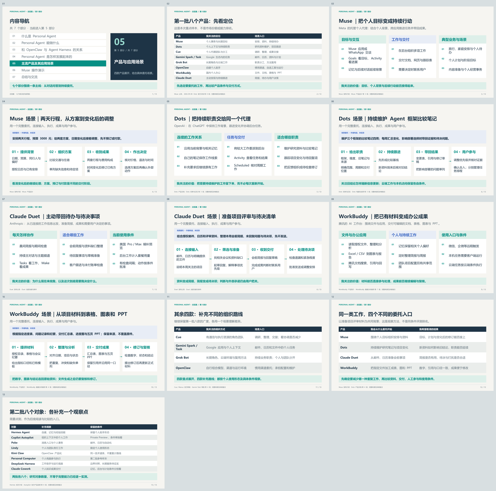

我把原第五部分完整保存在这里，包括四个构造场景、产品阅读记录及原有幻灯片。当前总览篇已改用[主流产品概览](../01-introduction/#五主流-personal-agent-产品概览)，按厂商、推出时间、生态和业务侧重介绍产品。

以下保留原文的时间与资料口径；“约 25 分钟”是旧版安排，不计入当前正文的约 46 分钟。场景没有新增实测，也不用于证明某项任务只有某个产品能够完成。原有 PPT、PDF 和讲者备注仍可查阅。

[原有讲者备注](../01-introduction/images/05-product-scenarios-appendix-notes.txt)

## 五、主流产品及其应用场景

本节约 25 分钟。[配套 PowerPoint](../01-introduction/images/05-product-scenarios-appendix.pptx) · [PDF 预览](../01-introduction/images/05-product-scenarios-appendix.pdf)

有了前面的定义，我接下来更想看清楚产品实际把哪些工作交给了 Agent。这里重点展开 **Muse、Dots、Claude Duet 和 WorkBuddy**：各用一个产品视角和一个完整场景，连接输入、执行、交付与用户参与。其余产品帮助我观察不同路线，不做同样篇幅的展开。

下文的能力依据官方资料，适用场景是我的理解；委托文字和过程表都是我构造的示例，没有新增账号实测。不同产品可以覆盖相同工作，以下侧重不代表独占能力，也不用于排名。

### 第一批八个产品：先建立一张产品地图

| 产品与本地笔记 | 我关注的定位 | 场景入口 | 本节安排 |
| --- | --- | --- | --- |
| [Muse](../../muse/) | 个人事务与长期目标 | 行程、个人计划、经营事务 | 重点展开 |
| [Dots](../../dots/) | 个人上下文与持续职责 | 研究资料维护、项目变化跟进 | 重点展开 |
| [Claude Duet](../../claude-duet/) | 主动发现与工作跟进 | 晨间简报、会前准备、待决事项 | 重点展开 |
| [WorkBuddy](../../workbuddy/) | 国内个人办公与成果交付 | 文件整理、数据分析、文档与 PPT | 重点展开 |
| [Cue](../../cue/) | 具有通信资源的个人代理团队 | 多角色调研、整理与交接 | 简要介绍 |
| [Gemini Spark / Task](../../gemini-spark/) | Google 生态中的个人任务 | 邮件、日历、资料与持续跟踪 | 简要介绍 |
| [Grok Bot](../../grok-bot/) | 长期角色与云端工作 | 职责分工、方法复用 | 简要介绍 |
| [OpenClaw](../../openclaw/) | 可自行部署与组合的个人助手 | 惯用通信渠道、自选工具与运行 | 简要介绍 |

### Muse：围绕个人目标，把分散事务组织起来

#### 我怎样理解它的产品体验

Muse 是 Meta 提供的托管个人代理，可以通过 Muse 应用或 WhatsApp 交谈。它将个人背景、任务与目标放进持续交互中：用户说明想做成什么，系统组织步骤，在后台继续工作，再带回成果或需要用户决定的事项。[Muse 发布介绍](https://about.fb.com/news/2026/09/introducing-muse-personal-ai-agent/)

我读产品设计资料时，最有帮助的是几个可见入口：**Goals** 看跟踪中的目标，**Activity** 看当前工作和活动记录，**Artifacts** 承载文档、网页、跟踪表或交互式成果。它们把“告诉我怎么做”扩展成了“保存计划、推进工作、交付结果”的使用过程。长期对话、可调整的主动消息与可查看的记忆，则帮助减少重复交代。[官方产品设计](https://introducing.muse.ai/)

我会用三类工作理解它的范围：生活安排，例如旅行和家庭待办；持续个人目标，例如围绕时间与已有记录维护计划；个人经营，例如依据店铺资料整理内容、经营分析和回复草稿。第三类已有 Muse for Small Business 的技能与连接器公告，涉及 Shopify、Canva、QuickBooks 等工具，但实际动作仍以连接与授权为前提。[经营场景公告](https://about.fb.com/news/2026/09/introducing-muse-small-business/)

#### 场景：准备一次两天行程，并在条件变化后继续调整

我构造的委托是：

> 下个月安排一次两天行程，预算不超过 3000 元，尽量避开工作日上午出发。结合我提供的日历和出行偏好，比较交通与住宿，给我两套方案。先保留待定项，不预订、不付款；时间变化后再调整。

| 环节 | 这个场景里具体要做什么 |
| --- | --- |
| 输入 | 日期范围、预算、同行人、交通偏好，以及允许使用的日历与资料 |
| 推进 | 整理约束，比较交通和住宿，将需要用户补充的信息单列 |
| 交付 | 两套方案、行程表、费用构成与待确认事项，而不只是景点推荐 |
| 延续 | 如果我改了出发时间，在现有方案上说明受影响的安排并修订 |
| 用户参与 | 选择方案，核对票价和退改条件；真正预订或付款另行确认 |

这个例子帮助我区分一次旅行问答与目标委托：有背景、有阶段成果，也有变化后的继续处理。它不是本轮已经跑通的案例，更不表示全部网站都可访问或所有价格都准确。

#### 使用时我会关注什么

我会先限定资料与动作范围，再检查 Activity 中的过程和交付内容。公开公告要求发送、发布和花费经过批准；已有的 [Gmail 连接与审批探索](../../muse/practice/analysis/)可以补充我当时观察到的界面，不能代表全部账号和场景。后面的 Muse 演示仍采用三份模拟材料，先观察基本委托和修订，不用一次演示证明长期目标能力。

### Dots：把持续职责交给同一个代理

#### 从一项任务到一份需要持续维护的工作

我理解 Dots 的入口是“给同一个 dot 一份职责”。它在 ChatGPT 中持续跟踪工作，用户可以补充背景、改变优先级，再让它接着处理。需要较大投入的部分，可以委派给后台任务；用户仍能继续与主 dot 交谈。[官方产品说明](https://learn.chatgpt.com/docs/dots)

它使用当前工作上下文、相关 ChatGPT 记忆和自己的笔记。对我而言，这比把所有历史都塞进每次任务更容易理解：一项职责可以延续，具体任务使用的资料仍有范围。按时间执行、受支持事件触发，以及根据进展暂停和继续，也是不同的安排方式。[任务与记忆](https://learn.chatgpt.com/docs/dots/tasks-and-memory)

我最想用它观察三类职责：持续维护研究资料、跟进一个项目的变化、将反馈转成待检查的修订任务。核心是“什么需要长期保持最新”，而不是一次要生成多长的报告。

#### 场景：持续维护一份 Agent 框架比较笔记

> 接下来四周，维护这三个 Agent 框架的比较笔记。先用我提供的旧表和官方来源清单补齐基线，再跟踪与运行平台有关的更新。每周五给我变更表；如果某项变化影响部署选择，单独带回证据和需要我决定的问题。文件修改先给草稿。

| 环节 | 这个场景里具体要做什么 |
| --- | --- |
| 输入 | 三个框架、关注维度、旧笔记、允许访问的来源和交付位置 |
| 首轮工作 | 检查旧结论和缺口，形成带版本、日期与引用的比较基线 |
| 后续工作 | 识别新资料对旧结论的影响，区分一般更新与影响选型的变化 |
| 交付 | 比较表、变更记录、修订草稿和待决事项；我可以继续追问依据 |
| 用户参与 | 调整范围，判断结论是否成立，确认是否合入已有笔记 |

我看重的是研究工作能否沿用已有决定，并在背景变化后接着推进。这里的四周跟踪是场景设计；是否支持指定事件、实际保存了什么排程，都要让产品确认，不能因为接入了一个来源就认定已经开始监控。

#### 云端与本机怎样影响使用

dot 有自己的云端电脑；需要本机文件、代码和应用时，可以另外连接个人电脑。本机工作要求电脑在线且 ChatGPT 应用打开。消息渠道、应用连接和电脑访问是三种不同的接入，不自动互相授权。[电脑与应用](https://learn.chatgpt.com/docs/dots/computers-and-apps)

我会通过 Activity 看具体任务与结果，通过 Scheduled 核对周期工作。停止主任务、停止委派任务和取消后续排程需要分别处理；“一次运行结束”也不自动等于成果已经交付。它的适用性因此与来源接入、执行位置及账号可用范围直接相关。[工作检查与控制](https://learn.chatgpt.com/docs/dots/controls)

### Claude Duet：把分散信息转成值得处理的事项

#### 主动性体现在哪里

我理解 Duet 的主要入口是日常消息和工作关注：早晨给出简报，期间检查已连接应用，准备能够先做的工作，再把结果或需要判断的事项带回来。它既能接受明确任务，也试图发现尚未被用户逐项交代的工作。[2026-10-21 发布公告](https://claude.com/resources/articles/claude-duet)

产品体验包括持续主对话、主题频道、查看进展与待输入事项的 **Tasks**，以及收取较大成果的 **Make**。它沿用 Claude 账号的记忆、Skills 和连接器，在自己的云端电脑工作；研究简报、表格模型、幻灯片或仪表板都在官方举例范围内。我更关心的是这些成果是否对应了我的实际待办，而不只看生成了什么文件。[入门与功能说明](https://support.claude.com/en/articles/17631495-get-started-with-claude-duet)

我会用会前资料准备、未回复事项整理、客户与账单跟进理解它。Gmail、日历和文件可以提供工作背景；官方还用 Stripe 未付账单与提醒邮件草稿说明经营事务。这些动作各有连接条件，不表示所有连接器都支持相同操作。

#### 场景：为一周项目评审准备简报和待决清单

> 结合我授权的邮件、日历和评审资料，准备本周项目评审清单。列出需要提前阅读的材料、尚未回复的问题，以及需要我作决定的事项。先准备简报和回复草稿；缺少材料时问我，不替我承诺时间，也不直接发送。

| 环节 | 这个场景里具体要做什么 |
| --- | --- |
| 输入 | 已授权邮件、日历、明确提供的评审文件，以及关注优先级 |
| 筛选 | 找出相关会议、待回复线索和资料缺口，说明为什么值得处理 |
| 准备 | 汇总背景、组织会前简报，起草回复并整理用户待决项 |
| 交付 | 简报、草稿和任务状态；在完成或需要决定时联系用户 |
| 用户参与 | 检查遗漏和紧急程度，决定回复内容、是否发送及是否调整安排 |

这个场景的价值在于减少我反复翻邮件、找材料和回忆待办的负担。它不包含自动参加会议，也不假定 Duet 已能读取所有 Claude 项目或本机文件。公告的“主动”也存在检查间隔，不能用作实时告警的保证。

#### 当前条件，以及与 Cowork 的关系

截至本次读取，Duet 是面向美国 Pro / Max 用户、按候补邀请开放的研究预览，后台工作计入同一套餐用量。帮助页还说明当前不能查看或接管其浏览器，部分连接器有限制，Microsoft 365 尚未提供。判断能否落到某项工作时，这些条件比泛称“支持办公生态”更具体。

我仍把 Duet 与 Cowork 分开理解：Duet 更突出主动发现和持续跟进，Cowork 更适合从明确的知识成果委托来观察。二者都有交集，Cowork 也有后台与计划工作，Duet 也能完成一次性任务。[已有差异笔记](../../claude-duet/product/positioning-and-cowork/)

### WorkBuddy：把已有材料变成可继续使用的办公成果

#### 从文件和办公应用进入工作

WorkBuddy 是腾讯提供的 AI 工作台，个人使用时可以围绕文件、资料和应用委托工作。对我来说，最直观的入口是读取材料、整理分析，再交付可编辑的文档、表格、PPT 或网页。[官方简介](https://www.workbuddy.cn/docs/workbuddy/Overview)

它的资料处理并不限于生成一段正文。官方案例说明了从 Excel / CSV 输入、指定指标和统计范围，到计算、绘图与报告交付的过程；腾讯文档接入则覆盖搜索、引用和回写。[数据分析案例](https://www.workbuddy.cn/docs/workbuddy/From-Beginner-to-Expert-Guide/Practice-Cases/Practice-Three)、[腾讯文档接入](https://www.workbuddy.cn/docs/workbuddy/From-Beginner-to-Expert-Guide/Function-Description/Knowledge-Base/Tencent-Doc)

我会用周报与经营分析、批量文件整理、研究材料转文档或 PPT 来理解它。个人记忆可以保存与当前工作相关的偏好；需要周期汇总时，可以另外配置定时任务。项目功能则还有团队共享上下文的范围，不能与个人记忆混为一谈。[个人记忆](https://www.workbuddy.cn/docs/workbuddy/From-Beginner-to-Expert-Guide/Function-Description/Memory)、[项目](https://www.workbuddy.cn/docs/workbuddy/From-Beginner-to-Expert-Guide/Function-Description/Project)

#### 场景：把一周项目材料整理成分析表和五页汇报

> 根据指定目录里的进度表、问题记录和会议纪要，整理本周项目进展。给我一份可编辑汇总表、一张进度图和五页 PPT。区分已完成、进行中与待确认事项；每条结论保留来源，缺失数据不要补猜，先不覆盖原文件。

| 环节 | 这个场景里具体要做什么 |
| --- | --- |
| 输入 | 授权目录或上传文件、指标口径、已有模板和文件输出位置 |
| 处理 | 对齐项目名称、时间与状态，合并重复项，把冲突和缺失单列 |
| 分析 | 按指定口径统计和绘图，区分材料事实与需要判断的风险 |
| 交付 | 汇总表、图表与五页 PPT；继续修改时沿用相同来源和口径 |
| 用户参与 | 复核数字、状态和引用，提出修订，确认是否更新正式材料 |

这里“一组材料到一组可编辑成果”是我设计的组合任务，不是官方案例的复述，也没有新增执行结果。我会重点检查数字能否回到原表、图表口径是否一致，以及 PPT 是否保留了必须说明的不确定性。

#### 远程入口与运行条件

WorkBuddy 的助理支持从微信、企业微信、QQ、钉钉和飞书等入口触发电脑上的工作；这条路径需要电脑开机并运行客户端。定时任务另有本地、项目与云端来源，带云端标识的任务在云端沙箱执行，无需本机在线。我会先确认文件在哪里、任务在哪里运行，再决定采用哪种路径。[远程助理](https://www.workbuddy.cn/docs/workbuddy/From-Beginner-to-Expert-Guide/Function-Description/Assistant)、[定时任务](https://www.workbuddy.cn/docs/workbuddy/From-Beginner-to-Expert-Guide/Function-Description/Automation-Guide)

### 其余四款：补充不同的入口与组织方式

| 产品 | 我希望借它观察的差异 | 一个场景入口 |
| --- | --- | --- |
| Cue | 用有通信与执行资源的多个角色组织工作 | 一个角色调研、一个整理，再交接成果；看分工是否减少协调 |
| Gemini Spark / Task | 围绕已有 Google 应用与上下文承接任务 | 从邮件、日历和文件组织工作；具体指 Task 形态 |
| Grok Bot | 用长期角色、云端环境与可复用方法工作 | 持续整理某类业务信息；个人与团队使用分别看 |
| OpenClaw | 由运行者组合渠道、模型、工具与状态 | 从惯用通信渠道使用自建助手，同时承担部署维护 |

这些路线仍属于第一批研究范围。背景来源沿用 [Cue 官方帮助](https://help.manus.im/zh-CN/articles/17190150-manus-2-0-有哪些新变化)、[Gemini Task 帮助](https://support.google.com/gemini/answer/17094507?hl=en)、[Grok Bot 概览](https://docs.x.ai/grok-bot/overview)与 [OpenClaw 文档](https://docs.openclaw.ai/)，本轮不将四款重点资料的回查扩大为其他产品的版本审计。

### 把四个重点产品放回同一类工作

读完具体场景后，我再回到“准备一份项目评审材料”这项共同工作。以下是我选择观察入口的方法，不是同条件测评得出的优劣。

| 产品 | 我会从什么委托开始 | 重点看什么结果 |
| --- | --- | --- |
| Muse | 围绕一个个人目标组织资料、安排和后续待办 | 目标、计划与变化后的修订是否接得起来 |
| Dots | 持续维护研究笔记与项目变化 | 新资料怎样影响旧结论，职责能否延续 |
| Claude Duet | 从邮件与日历发现会前准备和待回复事项 | 简报是否有用，待决项是否准确，打扰是否合适 |
| WorkBuddy | 把明确提供的文件加工成表、图和 PPT | 数字、引用与口径是否一致，文件是否便于修改 |

四款都可能写报告、处理文件或持续工作。我先选这些不同入口，是为了看清产品怎样减少资料搬运、重复交代与人工跟进，再用相同材料和验收标准继续验证。

### 第二批八个产品的补充观察

第二批我只保留一个观察点，作为后续阅读入口。

| 产品与本地笔记 | 补充观察点 | 按当前定义怎样处理 |
| --- | --- | --- |
| [Hermes Agent](../../hermes-agent/) | 自建助手的记忆、经验技能和持续工作 | 保留个人助手形态，运行需要可用宿主；[官方介绍](https://hermes-agent.nousresearch.com/) |
| [Copilot Autopilot](../../copilot-autopilot/) | 在组织资料与治理范围内服务个人 | 公开定位符合，仍标注 Private Preview；[官方产品说明](https://www.microsoft.com/en-ca/copilot/) |
| [Poke](../../poke/) | 从日常消息入口委托邮件、日历等事务 | 消息入口型个人代理；[产品说明](https://poke.com/) |
| [Lindy](../../lindy/) | 个人上下文与团队例行工作共存 | 按个人使用形态纳入，团队模式单独看；[记忆作用域](https://docs.lindy.ai/teammate/memory) |
| [Kimi Claw](../../kimi-claw/) | OpenClaw 的托管、会员和设备产品化 | 保留，属于 OpenClaw 谱系；[官方帮助](https://www.kimi.com/help/kimi-claw/overview) |
| [Perplexity Personal Computer](../../personal-computer/) | 个人文件、原生应用和电脑环境参与执行 | 作为第二批参考；[产品页](https://www.perplexity.ai/personal-computer) |
| [DeepSeek Harness](../../deepseek-harness/) | 工作助手与运行底座并存 | 边界对照，持续个人服务仍需证据；[记忆接入条件](https://deepseek-harness.github.io/deepseek-harness/en/guide/mcp-memory) |
| [Claude Cowork](../../claude-cowork/) | 个人知识工作、文件交付与后台任务 | 保留个人工作代理形态；[多端与云端说明](https://support.claude.com/en/articles/15520349-use-claude-cowork-on-web-desktop-and-mobile) |

**资料说明：** 四个重点产品的上述官方来源于 2026-10-25 回查；动态帮助页不以阅读日代替发布日期，具体来源与版本条件见[本节来源记录](../01-introduction/images/05-product-scenarios-references.txt)。其余产品沿用 2026-10-24 的资料范围。场景为我构造的委托，不是执行报告；只有 Muse 已有的原创实践另有记录，不能将其扩展为四款同条件实测。两批名单保持 8 + 8，完整材料见[第一批比较](../../first-batch-summary/)与[第二批比较](../../second-batch-summary/)。

