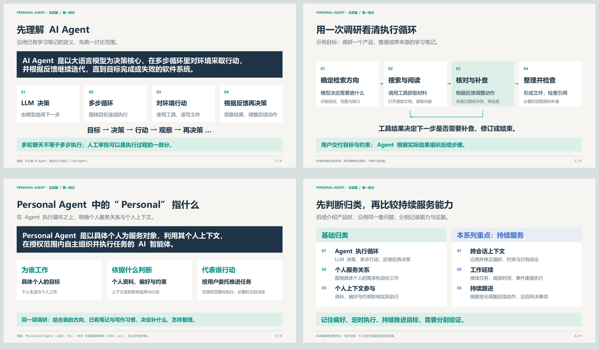
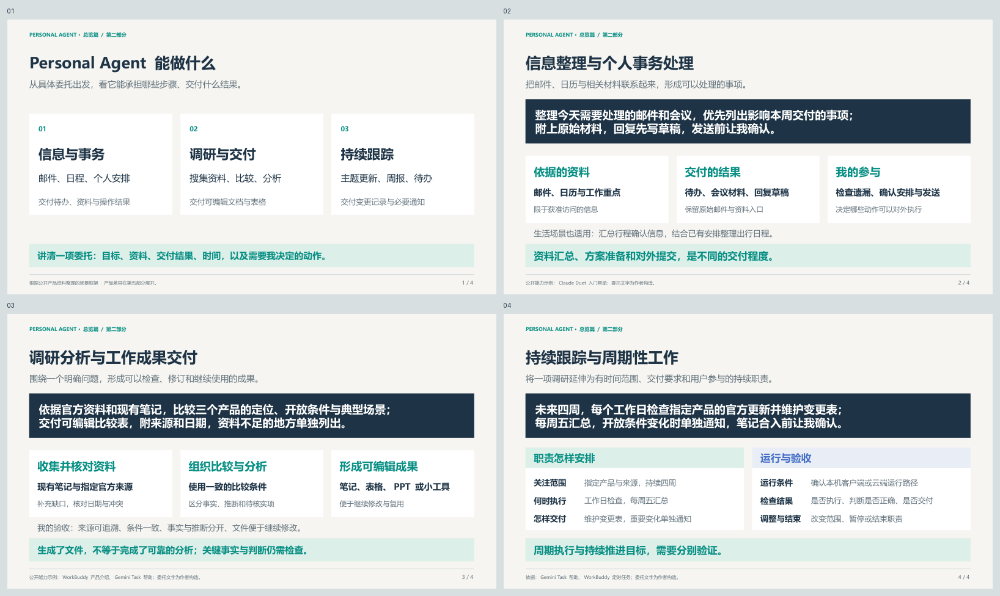
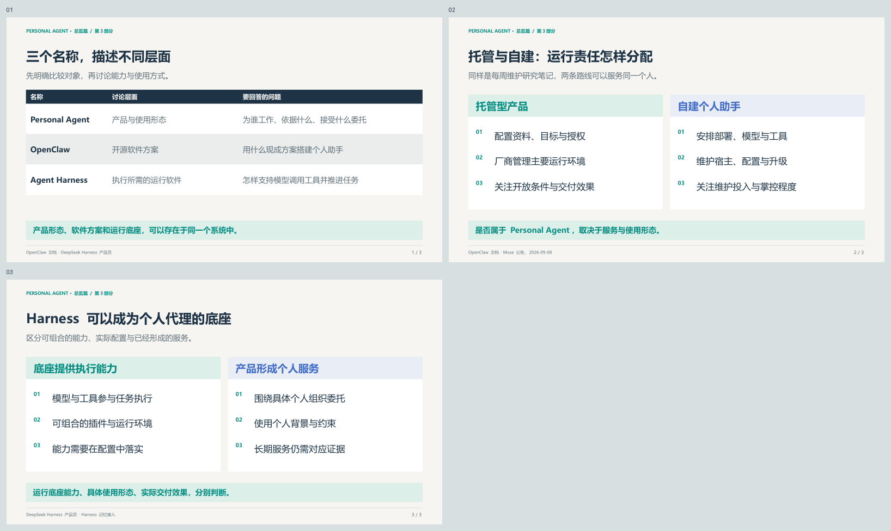
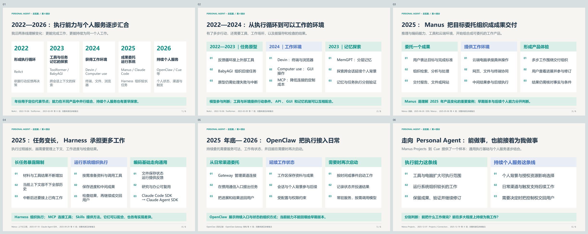
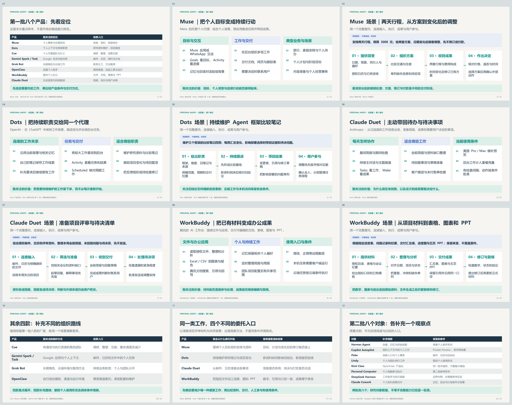
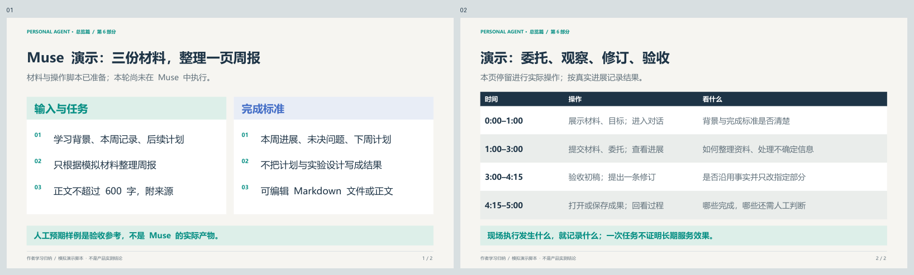
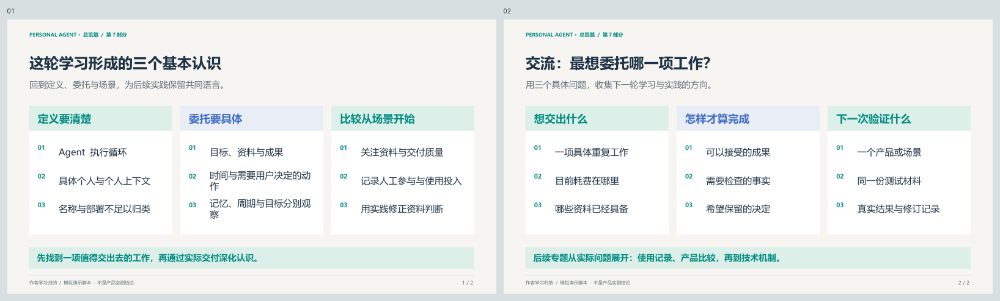

## 前言

这篇笔记是我对 Personal Agent 的概念、能力、发展脉络和主流产品的阶段性认识的总结。我希望先把 Personal Agent 的产品形态与使用场景联系起来，再通过一个简单的 Muse 演示，观察任务委托与成果交付的过程。技术实现细节留到后续专题继续分享。

分享计划：当前为完整修订稿，按约 **50 分钟**安排：前四部分 15 分钟，主流产品与场景 25 分钟，Muse 演示 5 分钟，总结与交流 5 分钟，其中交流约 3 分钟。正文用于阅读与复盘；现场以幻灯片和具体例子为主，产品表格不逐项宣读。

- [完整 PowerPoint](images/00-personal-agent-introduction.pptx) 
- [完整 PDF](images/00-personal-agent-introduction.pdf) 
- [逐页讲述提示](images/00-introduction-speaker-notes.txt)

## 什么是 Personal Agent

本节约 4 分钟。[配套 PowerPoint](images/01-what-is-personal-agent.pptx) · [PDF 预览](images/01-what-is-personal-agent.pdf)

### 先理解 AI Agent

讨论 Personal Agent 之前，我们先看看什么是 Agent。这里我先给出一个我参考社区各种说法之后的个人总结的 [AI Agent 的定义](/definition/what-is-ai-agent/)：

> **AI Agent 是以大语言模型为决策核心，在多步循环里对环境采取行动，并根据反馈继续迭代，直到目标完成或失败的软件系统。**

这个定义包含四个要素：**由模型决定下一步，能够多步执行，能够对环境采取行动，并根据行动结果继续决策。** 这是我总结的 AI Agent 的定义，范围比传统人工智能中的 Agent 更窄。

以“调研一个产品并整理笔记”为例，Agent 可以先搜索资料、打开原始文档，发现来源过期或说法冲突后补查，再整理文件、检查引用。模型根据每一步的结果决定下一步，形成“决策 → 行动 → 观察 → 再决策”的循环。

因此，**多轮聊天不等于多步执行**，单次工具调用也不足以说明存在这样的循环。用户可以随时补充要求或审批重要动作，自主执行并不要求全程无人参与。

### Personal Agent 中的“Personal”指什么

研究资料对 Personal Agent 的表述各有侧重：2024 年的[综述](https://arxiv.org/html/2401.05459v2#S3)强调与个人数据、设备和服务结合；W3C AI Agent Protocol 社区组的[用例材料](https://www.w3.org/2024/01/webevolve-series-events/annual-2025/slides/ai-agent-protocol-cg.pdf)强调代理代表的用户及其利益。后者是社区组讨论材料，不是 W3C 正式标准。

结合这些资料，我在本次调研中采用以下定义：

> **Personal Agent 是以具体个人为服务对象，利用其个人上下文，在授权范围内自主组织并执行任务的 AI 智能体。**

我主要从三个方面理解其中的“个人”：

- **为谁工作**：服务于具体个人的目标，既包括生活事务，也包括个人工作。
- **依据什么判断**：个人资料、偏好、工作背景和约束会影响选择与行动，Personal Agent 不只是给通用助手简单换一个名字。
- **代表谁行动**：根据用户委托使用工具、推进任务，并在需要时把决定权交回用户。

仍以调研为例：如果它能结合我的研究方向、已有笔记和写作习惯，优先补充尚未覆盖的资料，按我要求的方式整理，个人上下文就实际参与了工作。这里描述的是一个示例，用于解释判断方式，不是某个产品的实测结果。

### Personal Agent 调研范围选择

在做这次 Personal Agent 系列分享之前，我对目前社区的主要 Personal Agent 产品进行了调研。我会先检查产品是否具备前述 Agent 执行循环（先判断是不是 AI Agent），再判断它是否围绕具体个人工作、个人上下文是否影响执行（再看是不是 Peasonal Agent）。注意：不能仅凭“个人使用”或产品名称就定义是或者不是 Personal Agent 。

在基础归类之上，我认为 Personal Agent 应该更关注**能够长期服务个人、跨会话延续工作的代理**。因此，我我会进一步分别检查：

| 观察维度 | 要确认的问题 |
| --- | --- |
| 跨会话上下文 | 能否在后续工作中沿用并修正偏好、约束和已有结论？ |
| 工作延续 | 能否继续未完成的任务，或按时间、事件承担重复性工作？ |
| 持续跟进 | 能否根据变化调整后续动作，并在需要用户判断时联系用户？ |

记住偏好、定时执行与持续推进目标，是不同的能力，不能相互替代。长期服务是本系列的研究重点，不把所有能力齐备作为统一的准入门槛；单次委托也可以发生在 Personal Agent 中。

独立电脑、云端常驻、多代理协作属于具体产品路线。后面介绍主流产品时，我会沿用上述标准，区分个人使用形态、团队模式和运行底座，并将官方说明与实际验证分开记录。

**资料说明：** 本节整理于 2026-10-24。综述使用 2024-05-08 修订的 v2；社区组材料来自 2025 年活动，两项外部来源均于 2026-10-24 阅读。Personal Agent 的工作定义与判断方法是我的归纳，不代表统一行业标准。

## Personal Agent 能做什么

本节约 4 分钟，先概览三类委托，具体产品和场景在第五部分展开。

有了定义，我更关心哪些工作可以交给 Personal Agent。我把调研中看到的应用归为三类：信息与事务、调研与交付、持续跟踪。下面用具体委托说明输入、处理过程和交付结果，不要求每个产品都具备全部能力。

### 信息整理与个人事务处理

日常有不少工作分散在邮件、日历和文件中：判断哪些消息需要回复，找出会议前要看的资料，或者协调一个合适的时间。这类工作的难点往往在于把相关信息联系起来，并落实后续动作。

例如，可以这样委托：

> 帮我整理今天需要处理的邮件和会议。优先列出影响本周交付的事项，附上原始邮件和相关材料；需要回复的先写草稿，发送前让我确认。

这项委托需要读取获准访问的邮件和日历，结合我的工作重点筛选事项，再形成待办清单、会议资料和回复草稿。我需要检查它是否遗漏关键事项、安排是否合适，并决定哪些内容可以发出。晨间邮件与日历简报、回复草稿已有相应的[官方产品说明](https://support.claude.com/en/articles/17631495-get-started-with-claude-duet)。

同样的方式也可以用于生活事务，例如汇总行程确认信息，结合已有安排整理出行日程。具体能读取哪些服务、能否修改日程或完成预订，取决于产品接入与授权范围。**资料汇总、方案准备和对外提交，是不同的交付程度。**

### 调研分析与工作成果交付

与我的工作更相关的一类，是把分散资料整理成可以继续使用的成果。我希望委托的不仅是检索，还包括筛选来源、核对差异、组织分析，以及按要求更新文档和表格。

例如：

> 根据指定的官方资料和现有笔记，比较三个产品的定位、开放条件与典型场景。把结论写入比较表，附上来源和日期；资料不足的地方单独列出，不替我补猜。

这项工作需要利用已有材料确定比较范围，再补充资料、交叉核对，并形成可编辑的文件。输出可以是研究笔记、数据分析表、演示材料，也可以是一个用于展示结果的小工具。文件处理、自主规划执行与文档、表格、PPT 交付，可以在 [WorkBuddy 的公开说明](https://www.workbuddy.cn/docs/workbuddy/Overview)中找到具体例子。

我会把验收重点放在来源能否追溯、比较条件是否一致、事实与推断是否分开，以及成果是否便于继续修改。**生成了文件，不等于完成了可靠的分析。** 关键判断仍需要我检查，缺少资料时也应保留问题。

### 持续跟踪与周期性工作

前两类委托可以有明确的结束点。还有一些工作需要重复进行，并在发生变化时接着处理，例如主题跟踪、周报整理和待办跟进。

我可以把前面的调研延伸为一项持续职责：

> 未来四周，每个工作日检查指定产品的官方更新。维护变更表，标明发布日期与来源；每周五给我一份汇总。如果开放条件发生变化，单独通知我。先准备笔记补充草稿，合入前让我确认。

这比“每天给我一份新闻”更具体：它说明关注对象、时间范围、交付位置，以及哪些变化需要打扰我。[Gemini Task 官方帮助](https://support.google.com/gemini/answer/17094507?hl=en)包含持续任务、信息跟踪和文件交付的示例，但具体触发与动作仍需按产品确认。

持续工作还需要可用的运行环境。以 [WorkBuddy 定时任务](https://www.workbuddy.cn/docs/workbuddy/From-Beginner-to-Expert-Guide/Function-Description/Automation-Guide)为例，本地任务由本机客户端执行，云端任务则在云端沙箱运行、无需电脑在线；不能把一种路径的条件套到另一种路径。

对这类委托，我会关注每次检查是否执行、变化是否判断正确、结果是否交付，以及怎样调整或结束这项职责。周期执行不自动等于持续推进目标，后台工作也会受到资源、权限和用量限制。

从这些场景出发，我表达委托时会尽量讲清楚：**做什么、依据哪些资料、交付什么结果、什么时候完成，以及哪些动作需要我决定。** 后面比较产品，也会沿着这些具体工作看它们各自擅长什么。

**资料说明：** 本节整理于 2026-10-24，引用的四篇官方帮助与产品说明均于当日读取，属于动态文档，不将阅读日期当作发布日期。以上委托为我归纳的场景示例，没有新增产品实测；可用能力取决于地区、套餐、版本、连接服务及具体授权，产品差异留到第五部分展开。

## 和 OpenClaw 与 Agent Harness 的关系

本节约 2 分钟，先区分产品形态与运行软件，不展开技术实现。

### 产品形态、开源方案与运行底座

我最初整理清单时，发现有个一个问题必须回答：Muse，Dots，cue 等典型 personal Agent 和 OpenClaw / Harness 等其他 Agent 产品，是否应该放在一起研究？这里首先要区分它们描述的是哪个层面。

| 名称 | 我在本次讨论中的用法 | 主要回答什么问题 |
| --- | --- | --- |
| Personal Agent | 面向具体个人的代理产品或使用形态 | 为谁工作，依据哪些个人上下文，接受什么委托？ |
| OpenClaw | 可自行运行、连接通信渠道与 Agent 能力的开源软件 | 用什么现成方案搭建和使用个人助手？ |
| Agent Harness | 支撑模型调用工具、推进执行、保存运行状态等工作的运行软件 | Agent 怎样获得持续执行任务所需的环境与控制？ |

因此，它们不是同一层面的三个互斥类别。可以用 Harness 构建面向个人的产品，也可以把 OpenClaw 配置成自己的 Personal Agent。反过来，单独提供运行组件，并不自动意味着已经形成面向个人的完整服务。

以同一个“每周更新研究笔记”的需求为例，使用托管产品时，我主要配置资料、委托和应用授权；采用自建方案时，还需要安排部署、模型接入和后续维护。两条路线都可以服务个人，差别在于谁承担配置与运行责任。

这里对 Harness 的说明是为了建立比较层次，不展开组件结构，也不把“使用了某种底座”当成产品效果的保证。

### 为什么这些概念会有交集

OpenClaw 的[官方文档](https://docs.openclaw.ai/)明确区分个人助手与团队部署，并提供会话、记忆、工具和自动化能力。按第一部分的定义，配置为围绕我工作、利用我的上下文并执行任务时，它可以属于 Personal Agent。开源、自建和终端入口都不是排除理由。

不过，我不会从“已安装 OpenClaw”直接推导出“已经得到可靠的长期助手”。它能访问什么、如何延续任务，以及宿主停止后还能做什么，仍取决于实际配置与运行条件。对个人使用者，这是维护成本和掌控程度之间的选择。

DeepSeek Harness 则展示了另一种交集：[官方产品页](https://www.deepseek.com/en/harness/)既提供桌面／Web 工作助手，也提供可组合的运行底座。用户已经可以直接交付文件处理、研究和开发任务，但其[外部记忆接入示例](https://deepseek-harness.github.io/deepseek-harness/en/guide/mcp-memory)默认关闭，不能仅凭可扩展性确认长期个人服务已经成立。

所以，后续比较我会区分三件事：**运行底座提供什么能力，具体配置形成什么使用形态，实际任务交付达到什么效果。** 同一个名称可以覆盖多个层面，判断仍要回到用户实际使用的对象。

**资料说明：** 本节官方文档读取于 2026-10-24；Harness 的概括及层次关系为我的工作性归纳。DeepSeek Harness 保留为边界对照，不因为名称或默认可配置能力而直接判定其长期个人代理能力。

## Personal Agent 是怎样发展起来的

本节约 5 分钟，按关键变化串讲；正文保留展开资料供回看。[配套 PowerPoint](images/04-evolution.pptx) · [PDF 预览](images/04-evolution.pdf)

### 一条是执行能力，一条是持续个人服务

重新梳理这几年的资料后，我发现只列论文和产品的发布时间，还不足以解释今天的 Personal Agent。我更关注两条变化：**Agent 怎样越来越能完成工作，以及它怎样越来越能持续为同一个人工作。**

| 时间 | 执行能力与产品组织的变化 | 我用来理解的代表案例 |
| --- | --- | --- |
| 2022 | 根据行动反馈继续决策，形成多步执行循环 | ReAct |
| 2023 | 工具使用、目标驱动任务与记忆机制并行探索 | Toolformer、BabyAGI、MemGPT |
| 2024 | 终端、文件、浏览器与 GUI 组成更完整的工作环境 | Devin、Claude computer use、MCP |
| 2025 | 通用成果委托形成产品；长任务推动上下文、进度与验证管理，运行能力开始复用 | Manus、Claude Code / Agent SDK、长期 Agent harness |
| 2025 年底至 2026 | 执行能力与个人状态、通信渠道、调度和持续环境结合 | OpenClaw；Manus Projects 到 Cue，以及本次观察的个人代理产品 |

这是我的学习框架。各项能力有更早的研究来源，也在不同产品中并行组合，不能理解为所有产品都沿着一条路线依次升级。

### 2022—2024：从执行循环到工作环境

[ReAct](https://arxiv.org/abs/2210.03629) 于 2022-10-06 首次提交，研究推理与行动交替：模型采取动作、获取反馈，再决定下一步。2023 年的 [Toolformer](https://arxiv.org/abs/2302.04761) 研究模型怎样学习调用外部工具；[BabyAGI 作者记录](https://yoheinakajima.com/birth-of-babyagi/)则展示了围绕目标执行任务、根据结果产生后续任务并调整优先级的原型。

我把这些材料连起来理解：工具提供行动手段，反馈循环组织下一步，目标驱动的任务管理尝试把多步工作接起来。但有了循环，仍要解决“到哪里工作、能操作什么、怎样检查结果”。

2024 年 [Devin 的发布材料](https://cognition.com/blog/introducing-devin)提供了一个具体组合：沙箱电脑、终端、编辑器和浏览器。10 月的 [Claude computer use 公开测试](https://www.anthropic.com/news/3-5-models-and-computer-use)又增加了屏幕观察、鼠标和键盘操作路径；11 月发布的 [MCP](https://www.anthropic.com/news/model-context-protocol)则尝试降低数据和工具连接的定制成本。

这让我更清楚地看到模型与系统的区别：模型负责参与判断，执行环境提供文件、工具和软件操作能力。API 与 GUI 可以互补；接入了工具，也不意味着已经获得所有应用的权限。

### 2025：Manus 把目标委托组织成成果交付

2025 年是这条演进中需要重点补齐的一段。推理、编码与工具使用能力继续发展，例如 2 月发布的 [Claude 3.7 与 Claude Code 研究预览](https://www.anthropic.com/news/claude-3-7-sonnet)，将模型能力与终端执行产品放在同一轮发布中。我将其视为模型与运行环境结合的一个代表节点，不能由此推断所有长任务都已可靠。

同年 3 月推出的 Manus，把通用任务委托呈现给更广泛的用户。根据 [Manus 三个月回顾](https://manus.im/blog/what-we-saw-in-the-past-three-months-and-what-we-see-in-the-future)与 [E2B 当时的说明](https://e2b.dev/customers/how-manus-uses-e2b-to-provide-agents-with-virtual-computers)，它利用云端执行环境处理网页、文件和终端工作。对用户来说，委托对象可以是一份分析、一组材料或一个可交付成果，再由系统组织具体步骤。

Manus 对我理解产品演进的价值在于：**模型、工具和一台可以工作的电脑，被组织成了围绕成果的使用体验。** 云端执行也使任务有条件在用户离开当前界面后继续，但任务环境的寿命、可访问的数据与实际效果，仍要按当时版本判断。

这里的“成果委托”是一种产品变化，不代表 Manus 发明了通用 Agent，也不意味着我已验证它在任意任务上的完成率。它的早期通用任务形态，与后续面向个人的能力，需要分别观察。

### 2025：长任务推动 Harness 承担更多工作

能够执行多步任务之后，下一个问题是怎样继续执行。资料和工具结果不断增加，模型上下文却有限；工作中断或切换会话后，系统还要知道完成了什么、下一步做什么、结果是否通过检查。

Manus 在 2025-07-18 的[上下文工程文章](https://manus.im/blog/Context-Engineering-for-AI-Agents-Lessons-from-Building-Manus)中讨论了上下文组织、文件保存与执行成本。Anthropic 在 11 月的[长期 Agent harness 文章](https://www.anthropic.com/research/effective-harnesses-for-long-running-agents)中，进一步用进度记录、增量工作和验证说明多次上下文之间怎样交接。这些材料解释了 Harness 为什么重要：执行循环需要围绕状态、环境与反馈组织，才能承接更长的工作。

编码 Agent 是这种工程能力的重要来源之一。文件可以保存中间状态，运行和测试可以提供反馈；这些能力同样可以用于处理表格、资料和报告。2025-09-29，Anthropic 将 Claude Code SDK 更名为 [Claude Agent SDK](https://claude.com/resources/articles/building-agents-with-the-claude-agent-sdk)，明确说明其运行基础可用于研究、笔记和个人助理等非编码任务。

我因此把 Harness 看作执行能力复用的重要环节。它在不同项目中的范围不完全一致，也不等于已经形成个人代理。这里的概念与具体产品 DeepSeek Harness 分开；MCP、Skills 与 Harness 也可以在同一系统中配合，不是相互替代的历史阶段。

### 2025 年底至 2026：OpenClaw 把执行接入日常事务

如果希望持续委托工作，还需要一个可以再次联系、保留状态并重新启动任务的服务。[OpenClaw 的历史记录](https://docs.openclaw.ai/start/lore)将前身追溯到 2025 年底，并记录了 2026 年初的更名；当前能力则需要以当前文档为依据。

我从其[网关架构](https://docs.openclaw.ai/concepts/architecture)、[运行时](https://docs.openclaw.ai/concepts/agent)与[自动化文档](https://docs.openclaw.ai/automation/cron-jobs)中，看到几个互相配合的部分：Gateway 管理日常消息渠道与连接，工作区和会话保留背景与状态，调度机制在需要时启动工作并投递结果。

这解释了它为什么采用这种产品形态：用户可以从惯用渠道委托任务，已有状态可以参与后续工作，时间或事件又能触发新的执行。**常驻的是服务和状态管理，模型可以在需要时被调用。** 这与让一个执行循环无限运行不同；定时唤醒也不自动意味着能够正确处理所有待办。

OpenClaw 的实现仍在变化，不能把今天的工作区、记忆或自动化设计全部回填给初版。我更关注它体现的组织方式：把执行能力放进持续可达、有个人状态、可以继续工作的环境中。

### 怎样走向今天的 Personal Agent

个人上下文并非到 2026 年才出现。2023 年的 [MemGPT](https://arxiv.org/abs/2310.08560)已经研究有限上下文下的分层记忆与多会话交互；2025 年 12 月的 [Manus Projects](https://manus.im/blog/manus-projects)与 [Connectors](https://manus.im/blog/projects-connectors)，也已把可复用的工作指令、资料和应用连接组织进产品。

到 2026 年，本次观察的个人代理产品进一步组合执行、个人背景与持续服务。一个具体例子是 9 月发布的 [Manus 2.0](https://manus.im/blog/introducing-manus-2-0)：同一公告介绍了 Cascade harness、持续云端环境、事件触发，以及独立个人代理应用 Cue。它提供了观察通用执行基础怎样支持不同产品形态的线索，但“共用基础设施”不能证明各产品的记忆和交互采用完全相同的实现。

我理解，今天的 Personal Agent 来自多方面的结合：模型提供判断与生成能力，工具和环境让它能够行动，运行系统管理执行过程，个人上下文与授权资源影响具体选择，通信与触发机制支持后续工作。

因此，比较时仍要分别问：**它能把什么工作做完，以及它能在多大程度上持续为我工作。** 长任务能力、记忆与定时执行各有价值，任何一项都不足以单独证明完整的持续个人服务能力。

**资料说明：** 本节于 2026-10-25 补充整理。年份采用论文首次提交时间、原始公告及作者回顾；阶段划分与产品联系是我的归纳。早期预览、当前在线文档与厂商技术自述分别保留，不作为独立实测；2026 年是本次产品观察期，不代表 Personal Agent 在该年首次出现。完整来源与边界记录见[演进研究资料（文本）](images/04-evolution-research.txt)，相关历史笔记见[2025 年概述](/timeline/2025/overview/)。

## 五、主流产品及其应用场景

本节约 25 分钟。[配套 PowerPoint](images/05-products-and-scenarios.pptx) · [PDF 预览](images/05-products-and-scenarios.pdf)

有了前面的定义，我接下来更想看清楚产品实际把哪些工作交给了 Agent。这里重点展开 **Muse、Dots、Claude Duet 和 WorkBuddy**：各用一个产品视角和一个完整场景，连接输入、执行、交付与用户参与。其余产品帮助我观察不同路线，不做同样篇幅的展开。

下文的能力依据官方资料，适用场景是我的理解；委托文字和过程表都是我构造的示例，没有新增账号实测。不同产品可以覆盖相同工作，以下侧重不代表独占能力，也不用于排名。

### 第一批八个产品：先建立一张产品地图

| 产品与本地笔记 | 我关注的定位 | 场景入口 | 本节安排 |
| --- | --- | --- | --- |
| [Muse](../../muse/) | 个人事务与长期目标 | 行程、个人计划、经营事务 | 重点展开 |
| [Dots](../../dots/) | 个人上下文与持续职责 | 研究资料维护、项目变化跟进 | 重点展开 |
| [Claude Duet](../../claude-duet/) | 主动发现与工作跟进 | 晨间简报、会前准备、待决事项 | 重点展开 |
| [WorkBuddy](../../workbuddy/) | 国内个人办公与成果交付 | 文件整理、数据分析、文档与 PPT | 重点展开 |
| [Cue](../../cue/) | 具有通信资源的个人代理团队 | 多角色调研、整理与交接 | 简要介绍 |
| [Gemini Spark / Task](../../gemini-spark/) | Google 生态中的个人任务 | 邮件、日历、资料与持续跟踪 | 简要介绍 |
| [Grok Bot](../../grok-bot/) | 长期角色与云端工作 | 职责分工、方法复用 | 简要介绍 |
| [OpenClaw](../../openclaw/) | 可自行部署与组合的个人助手 | 惯用通信渠道、自选工具与运行 | 简要介绍 |

### Muse：围绕个人目标，把分散事务组织起来

#### 我怎样理解它的产品体验

Muse 是 Meta 提供的托管个人代理，可以通过 Muse 应用或 WhatsApp 交谈。它将个人背景、任务与目标放进持续交互中：用户说明想做成什么，系统组织步骤，在后台继续工作，再带回成果或需要用户决定的事项。[Muse 发布介绍](https://about.fb.com/news/2026/09/introducing-muse-personal-ai-agent/)

我读产品设计资料时，最有帮助的是几个可见入口：**Goals** 看跟踪中的目标，**Activity** 看当前工作和活动记录，**Artifacts** 承载文档、网页、跟踪表或交互式成果。它们把“告诉我怎么做”扩展成了“保存计划、推进工作、交付结果”的使用过程。长期对话、可调整的主动消息与可查看的记忆，则帮助减少重复交代。[官方产品设计](https://introducing.muse.ai/)

我会用三类工作理解它的范围：生活安排，例如旅行和家庭待办；持续个人目标，例如围绕时间与已有记录维护计划；个人经营，例如依据店铺资料整理内容、经营分析和回复草稿。第三类已有 Muse for Small Business 的技能与连接器公告，涉及 Shopify、Canva、QuickBooks 等工具，但实际动作仍以连接与授权为前提。[经营场景公告](https://about.fb.com/news/2026/09/introducing-muse-small-business/)

#### 场景：准备一次两天行程，并在条件变化后继续调整

我构造的委托是：

> 下个月安排一次两天行程，预算不超过 3000 元，尽量避开工作日上午出发。结合我提供的日历和出行偏好，比较交通与住宿，给我两套方案。先保留待定项，不预订、不付款；时间变化后再调整。

| 环节 | 这个场景里具体要做什么 |
| --- | --- |
| 输入 | 日期范围、预算、同行人、交通偏好，以及允许使用的日历与资料 |
| 推进 | 整理约束，比较交通和住宿，将需要用户补充的信息单列 |
| 交付 | 两套方案、行程表、费用构成与待确认事项，而不只是景点推荐 |
| 延续 | 如果我改了出发时间，在现有方案上说明受影响的安排并修订 |
| 用户参与 | 选择方案，核对票价和退改条件；真正预订或付款另行确认 |

这个例子帮助我区分一次旅行问答与目标委托：有背景、有阶段成果，也有变化后的继续处理。它不是本轮已经跑通的案例，更不表示全部网站都可访问或所有价格都准确。

#### 使用时我会关注什么

我会先限定资料与动作范围，再检查 Activity 中的过程和交付内容。公开公告要求发送、发布和花费经过批准；已有的 [Gmail 连接与审批探索](../../muse/practice/analysis/)可以补充我当时观察到的界面，不能代表全部账号和场景。后面的 Muse 演示仍采用三份模拟材料，先观察基本委托和修订，不用一次演示证明长期目标能力。

### Dots：把持续职责交给同一个代理

#### 从一项任务到一份需要持续维护的工作

我理解 Dots 的入口是“给同一个 dot 一份职责”。它在 ChatGPT 中持续跟踪工作，用户可以补充背景、改变优先级，再让它接着处理。需要较大投入的部分，可以委派给后台任务；用户仍能继续与主 dot 交谈。[官方产品说明](https://learn.chatgpt.com/docs/dots)

它使用当前工作上下文、相关 ChatGPT 记忆和自己的笔记。对我而言，这比把所有历史都塞进每次任务更容易理解：一项职责可以延续，具体任务使用的资料仍有范围。按时间执行、受支持事件触发，以及根据进展暂停和继续，也是不同的安排方式。[任务与记忆](https://learn.chatgpt.com/docs/dots/tasks-and-memory)

我最想用它观察三类职责：持续维护研究资料、跟进一个项目的变化、将反馈转成待检查的修订任务。核心是“什么需要长期保持最新”，而不是一次要生成多长的报告。

#### 场景：持续维护一份 Agent 框架比较笔记

> 接下来四周，维护这三个 Agent 框架的比较笔记。先用我提供的旧表和官方来源清单补齐基线，再跟踪与运行平台有关的更新。每周五给我变更表；如果某项变化影响部署选择，单独带回证据和需要我决定的问题。文件修改先给草稿。

| 环节 | 这个场景里具体要做什么 |
| --- | --- |
| 输入 | 三个框架、关注维度、旧笔记、允许访问的来源和交付位置 |
| 首轮工作 | 检查旧结论和缺口，形成带版本、日期与引用的比较基线 |
| 后续工作 | 识别新资料对旧结论的影响，区分一般更新与影响选型的变化 |
| 交付 | 比较表、变更记录、修订草稿和待决事项；我可以继续追问依据 |
| 用户参与 | 调整范围，判断结论是否成立，确认是否合入已有笔记 |

我看重的是研究工作能否沿用已有决定，并在背景变化后接着推进。这里的四周跟踪是场景设计；是否支持指定事件、实际保存了什么排程，都要让产品确认，不能因为接入了一个来源就认定已经开始监控。

#### 云端与本机怎样影响使用

dot 有自己的云端电脑；需要本机文件、代码和应用时，可以另外连接个人电脑。本机工作要求电脑在线且 ChatGPT 应用打开。消息渠道、应用连接和电脑访问是三种不同的接入，不自动互相授权。[电脑与应用](https://learn.chatgpt.com/docs/dots/computers-and-apps)

我会通过 Activity 看具体任务与结果，通过 Scheduled 核对周期工作。停止主任务、停止委派任务和取消后续排程需要分别处理；“一次运行结束”也不自动等于成果已经交付。它的适用性因此与来源接入、执行位置及账号可用范围直接相关。[工作检查与控制](https://learn.chatgpt.com/docs/dots/controls)

### Claude Duet：把分散信息转成值得处理的事项

#### 主动性体现在哪里

我理解 Duet 的主要入口是日常消息和工作关注：早晨给出简报，期间检查已连接应用，准备能够先做的工作，再把结果或需要判断的事项带回来。它既能接受明确任务，也试图发现尚未被用户逐项交代的工作。[2026-10-21 发布公告](https://claude.com/resources/articles/claude-duet)

产品体验包括持续主对话、主题频道、查看进展与待输入事项的 **Tasks**，以及收取较大成果的 **Make**。它沿用 Claude 账号的记忆、Skills 和连接器，在自己的云端电脑工作；研究简报、表格模型、幻灯片或仪表板都在官方举例范围内。我更关心的是这些成果是否对应了我的实际待办，而不只看生成了什么文件。[入门与功能说明](https://support.claude.com/en/articles/17631495-get-started-with-claude-duet)

我会用会前资料准备、未回复事项整理、客户与账单跟进理解它。Gmail、日历和文件可以提供工作背景；官方还用 Stripe 未付账单与提醒邮件草稿说明经营事务。这些动作各有连接条件，不表示所有连接器都支持相同操作。

#### 场景：为一周项目评审准备简报和待决清单

> 结合我授权的邮件、日历和评审资料，准备本周项目评审清单。列出需要提前阅读的材料、尚未回复的问题，以及需要我作决定的事项。先准备简报和回复草稿；缺少材料时问我，不替我承诺时间，也不直接发送。

| 环节 | 这个场景里具体要做什么 |
| --- | --- |
| 输入 | 已授权邮件、日历、明确提供的评审文件，以及关注优先级 |
| 筛选 | 找出相关会议、待回复线索和资料缺口，说明为什么值得处理 |
| 准备 | 汇总背景、组织会前简报，起草回复并整理用户待决项 |
| 交付 | 简报、草稿和任务状态；在完成或需要决定时联系用户 |
| 用户参与 | 检查遗漏和紧急程度，决定回复内容、是否发送及是否调整安排 |

这个场景的价值在于减少我反复翻邮件、找材料和回忆待办的负担。它不包含自动参加会议，也不假定 Duet 已能读取所有 Claude 项目或本机文件。公告的“主动”也存在检查间隔，不能用作实时告警的保证。

#### 当前条件，以及与 Cowork 的关系

截至本次读取，Duet 是面向美国 Pro / Max 用户、按候补邀请开放的研究预览，后台工作计入同一套餐用量。帮助页还说明当前不能查看或接管其浏览器，部分连接器有限制，Microsoft 365 尚未提供。判断能否落到某项工作时，这些条件比泛称“支持办公生态”更具体。

我仍把 Duet 与 Cowork 分开理解：Duet 更突出主动发现和持续跟进，Cowork 更适合从明确的知识成果委托来观察。二者都有交集，Cowork 也有后台与计划工作，Duet 也能完成一次性任务。[已有差异笔记](../../claude-duet/product/positioning-and-cowork/)

### WorkBuddy：把已有材料变成可继续使用的办公成果

#### 从文件和办公应用进入工作

WorkBuddy 是腾讯提供的 AI 工作台，个人使用时可以围绕文件、资料和应用委托工作。对我来说，最直观的入口是读取材料、整理分析，再交付可编辑的文档、表格、PPT 或网页。[官方简介](https://www.workbuddy.cn/docs/workbuddy/Overview)

它的资料处理并不限于生成一段正文。官方案例说明了从 Excel / CSV 输入、指定指标和统计范围，到计算、绘图与报告交付的过程；腾讯文档接入则覆盖搜索、引用和回写。[数据分析案例](https://www.workbuddy.cn/docs/workbuddy/From-Beginner-to-Expert-Guide/Practice-Cases/Practice-Three)、[腾讯文档接入](https://www.workbuddy.cn/docs/workbuddy/From-Beginner-to-Expert-Guide/Function-Description/Knowledge-Base/Tencent-Doc)

我会用周报与经营分析、批量文件整理、研究材料转文档或 PPT 来理解它。个人记忆可以保存与当前工作相关的偏好；需要周期汇总时，可以另外配置定时任务。项目功能则还有团队共享上下文的范围，不能与个人记忆混为一谈。[个人记忆](https://www.workbuddy.cn/docs/workbuddy/From-Beginner-to-Expert-Guide/Function-Description/Memory)、[项目](https://www.workbuddy.cn/docs/workbuddy/From-Beginner-to-Expert-Guide/Function-Description/Project)

#### 场景：把一周项目材料整理成分析表和五页汇报

> 根据指定目录里的进度表、问题记录和会议纪要，整理本周项目进展。给我一份可编辑汇总表、一张进度图和五页 PPT。区分已完成、进行中与待确认事项；每条结论保留来源，缺失数据不要补猜，先不覆盖原文件。

| 环节 | 这个场景里具体要做什么 |
| --- | --- |
| 输入 | 授权目录或上传文件、指标口径、已有模板和文件输出位置 |
| 处理 | 对齐项目名称、时间与状态，合并重复项，把冲突和缺失单列 |
| 分析 | 按指定口径统计和绘图，区分材料事实与需要判断的风险 |
| 交付 | 汇总表、图表与五页 PPT；继续修改时沿用相同来源和口径 |
| 用户参与 | 复核数字、状态和引用，提出修订，确认是否更新正式材料 |

这里“一组材料到一组可编辑成果”是我设计的组合任务，不是官方案例的复述，也没有新增执行结果。我会重点检查数字能否回到原表、图表口径是否一致，以及 PPT 是否保留了必须说明的不确定性。

#### 远程入口与运行条件

WorkBuddy 的助理支持从微信、企业微信、QQ、钉钉和飞书等入口触发电脑上的工作；这条路径需要电脑开机并运行客户端。定时任务另有本地、项目与云端来源，带云端标识的任务在云端沙箱执行，无需本机在线。我会先确认文件在哪里、任务在哪里运行，再决定采用哪种路径。[远程助理](https://www.workbuddy.cn/docs/workbuddy/From-Beginner-to-Expert-Guide/Function-Description/Assistant)、[定时任务](https://www.workbuddy.cn/docs/workbuddy/From-Beginner-to-Expert-Guide/Function-Description/Automation-Guide)

### 其余四款：补充不同的入口与组织方式

| 产品 | 我希望借它观察的差异 | 一个场景入口 |
| --- | --- | --- |
| Cue | 用有通信与执行资源的多个角色组织工作 | 一个角色调研、一个整理，再交接成果；看分工是否减少协调 |
| Gemini Spark / Task | 围绕已有 Google 应用与上下文承接任务 | 从邮件、日历和文件组织工作；具体指 Task 形态 |
| Grok Bot | 用长期角色、云端环境与可复用方法工作 | 持续整理某类业务信息；个人与团队使用分别看 |
| OpenClaw | 由运行者组合渠道、模型、工具与状态 | 从惯用通信渠道使用自建助手，同时承担部署维护 |

这些路线仍属于第一批研究范围。背景来源沿用 [Cue 官方帮助](https://help.manus.im/zh-CN/articles/17190150-manus-2-0-有哪些新变化)、[Gemini Task 帮助](https://support.google.com/gemini/answer/17094507?hl=en)、[Grok Bot 概览](https://docs.x.ai/grok-bot/overview)与 [OpenClaw 文档](https://docs.openclaw.ai/)，本轮不将四款重点资料的回查扩大为其他产品的版本审计。

### 把四个重点产品放回同一类工作

读完具体场景后，我再回到“准备一份项目评审材料”这项共同工作。以下是我选择观察入口的方法，不是同条件测评得出的优劣。

| 产品 | 我会从什么委托开始 | 重点看什么结果 |
| --- | --- | --- |
| Muse | 围绕一个个人目标组织资料、安排和后续待办 | 目标、计划与变化后的修订是否接得起来 |
| Dots | 持续维护研究笔记与项目变化 | 新资料怎样影响旧结论，职责能否延续 |
| Claude Duet | 从邮件与日历发现会前准备和待回复事项 | 简报是否有用，待决项是否准确，打扰是否合适 |
| WorkBuddy | 把明确提供的文件加工成表、图和 PPT | 数字、引用与口径是否一致，文件是否便于修改 |

四款都可能写报告、处理文件或持续工作。我先选这些不同入口，是为了看清产品怎样减少资料搬运、重复交代与人工跟进，再用相同材料和验收标准继续验证。

### 第二批八个产品的补充观察

第二批我只保留一个观察点，作为后续阅读入口。

| 产品与本地笔记 | 补充观察点 | 按当前定义怎样处理 |
| --- | --- | --- |
| [Hermes Agent](../../hermes-agent/) | 自建助手的记忆、经验技能和持续工作 | 保留个人助手形态，运行需要可用宿主；[官方介绍](https://hermes-agent.nousresearch.com/) |
| [Copilot Autopilot](../../copilot-autopilot/) | 在组织资料与治理范围内服务个人 | 公开定位符合，仍标注 Private Preview；[官方产品说明](https://www.microsoft.com/en-ca/copilot/) |
| [Poke](../../poke/) | 从日常消息入口委托邮件、日历等事务 | 消息入口型个人代理；[产品说明](https://poke.com/) |
| [Lindy](../../lindy/) | 个人上下文与团队例行工作共存 | 按个人使用形态纳入，团队模式单独看；[记忆作用域](https://docs.lindy.ai/teammate/memory) |
| [Kimi Claw](../../kimi-claw/) | OpenClaw 的托管、会员和设备产品化 | 保留，属于 OpenClaw 谱系；[官方帮助](https://www.kimi.com/help/kimi-claw/overview) |
| [Perplexity Personal Computer](../../personal-computer/) | 个人文件、原生应用和电脑环境参与执行 | 作为第二批参考；[产品页](https://www.perplexity.ai/personal-computer) |
| [DeepSeek Harness](../../deepseek-harness/) | 工作助手与运行底座并存 | 边界对照，持续个人服务仍需证据；[记忆接入条件](https://deepseek-harness.github.io/deepseek-harness/en/guide/mcp-memory) |
| [Claude Cowork](../../claude-cowork/) | 个人知识工作、文件交付与后台任务 | 保留个人工作代理形态；[多端与云端说明](https://support.claude.com/en/articles/15520349-use-claude-cowork-on-web-desktop-and-mobile) |

**资料说明：** 四个重点产品的上述官方来源于 2026-10-25 回查；动态帮助页不以阅读日代替发布日期，具体来源与版本条件见[本节来源记录](images/05-product-scenarios-references.txt)。其余产品沿用 2026-10-24 的资料范围。场景为我构造的委托，不是执行报告；只有 Muse 已有的原创实践另有记录，不能将其扩展为四款同条件实测。两批名单保持 8 + 8，完整材料见[第一批比较](../../first-batch-summary/)与[第二批比较](../../second-batch-summary/)。

## 六、Muse 操作演示

本节约 5 分钟。[配套 PowerPoint](images/06-muse-demo.pptx) · [PDF 预览](images/06-muse-demo.pdf) · [演示材料包](images/06-muse-demo-materials.zip)

这一段我准备演示“把三份模拟学习材料整理成一页周报，并按反馈修改”。材料包已准备好，下面是操作脚本，尚未在 Muse 中执行。它用于展示使用过程，不声称一次操作可以验证长期记忆或持续目标能力。

### 选择一个适合现场展示的任务

输入是三份标明“模拟”的材料：学习背景、本周记录、后续计划。记录中明确区分已做事项与尚未执行的实验，并留有日期不详、计划变更等需要保留的不确定性。

我希望得到一份可编辑的 Markdown 周报，包含本周进展、未决问题和下周计划。内容只依据提供的材料，保留来源文件名，不把计划写成结果。这个任务输入短、验收清楚，准备阶段不需要连接真实邮箱或提交外部操作。

### 从任务委托到结果交付

我按下面的过程演示，具体入口以实际账号界面为准。

| 时间 | 操作 | 观察点 |
| --- | --- | --- |
| 0:00–1:00 | 展示输入材料和完成标准；在 Muse 新建对话 | 用户提供什么背景，任务怎样表达 |
| 1:00–3:00 | 提交材料与委托，查看进展或回应澄清 | 是否依据材料组织工作，缺信息时怎样处理 |
| 3:00–4:15 | 检查交付内容，提出一条修改要求 | 能否沿用当前材料和结果继续修订 |
| 4:15–5:00 | 打开或保存最终内容，回看验收点 | 哪些步骤完成，哪些仍需用户判断 |

首次委托使用以下文字，材料可通过账号支持的文件入口提供；若没有该入口，就把三份短文按文件名分段粘贴：

> 请只根据我提供的三份模拟材料，整理一份中文学习周报。分为“本周进展、未决问题、下周计划”，控制在 600 字以内。每项注明来源文件名。保留日期不详和待核验信息，不把计划或实验设计写成已完成。请生成可编辑的 Markdown 文件；如当前不能生成附件，就先完整输出 Markdown 正文供我保存。暂不联网、不发送给其他人，也不创建定时任务。

看到初稿后，我再提出一条有明确验收条件的修改：

> 请把“下周计划”缩减为三项，按依赖关系排序，保持“运行恢复实验尚未执行”的状态说明；其他部分和来源标注保留。

我会检查它是否保留了原始事实、是否只修改指定部分，以及交付文件能否继续编辑。材料包中的人工预期样例用于对照结构和事实，不是 Muse 实际输出。若现场执行等待较长，就依据真实进展说明卡点，展示输入与预期结构，不把人工样例冒充现场结果。

### 从演示中观察能力与使用边界

我希望借这个任务观察：能否结合给定背景完成多步骤整理，能否区分计划与结果，以及收到反馈后能否继续修订。实际发生了什么，现场再记录。

我仍需要确定目标、提供资料、检查事实和接受成果。材料保留了背景，不代表已经验证跨会话记忆；这次任务完成，也不代表已验证后台持续工作、外部应用操作或所有任务的成功率。这些问题留到后续实践，用真实记录逐项补充。已有的[个人探索笔记](../../muse/practice/analysis/)也继续与本次演示分开保存。

## 七、总结与交流

本节约 5 分钟，其中总结约 2 分钟、交流约 3 分钟。[配套 PowerPoint](images/07-takeaways.pptx) · [PDF 预览](images/07-takeaways.pdf)

### 对 Personal Agent 的几点基本认识

这轮学习让我形成三个基本认识。

第一，Personal Agent 先要具备 Agent 的执行循环，再看它是否围绕具体个人工作，个人上下文是否实际影响判断与行动。产品名称、外观和部署位置，都不足以单独完成归类。

第二，它可以承接个人事务、知识成果交付和持续跟踪，但任务的范围、交付物、使用条件与需要用户决定的动作要讲清楚。记住偏好、定时执行和持续推进目标，仍需分别观察。

第三，不同产品从生活事务、应用生态、个人办公、消息入口或自建运行出发。比较时先选定工作场景，再看资料接入、成果质量、人工参与和使用投入，比记住一张功能总表更有帮助。

### 后续值得继续学习的问题

交流时，我想围绕三个具体问题收集反馈：

1. 在自己的日常工作中，最想交出去的一项重复劳动是什么？
2. 怎样的成果可以接受，哪些决定仍希望由自己作出？
3. 哪个产品或场景值得下一次用同一份材料实际验证？

后续我会先把选定场景做成可复核的使用记录，保存输入、结果、修订过程和条件；再逐步研究个人上下文、工作延续与用户控制如何实现。本次的产品认识也会随着这些记录继续修正。

